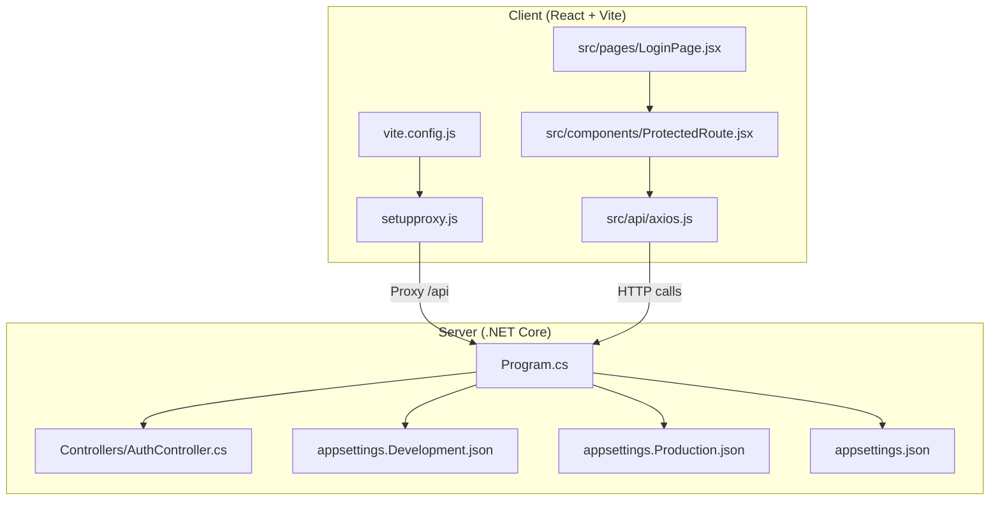
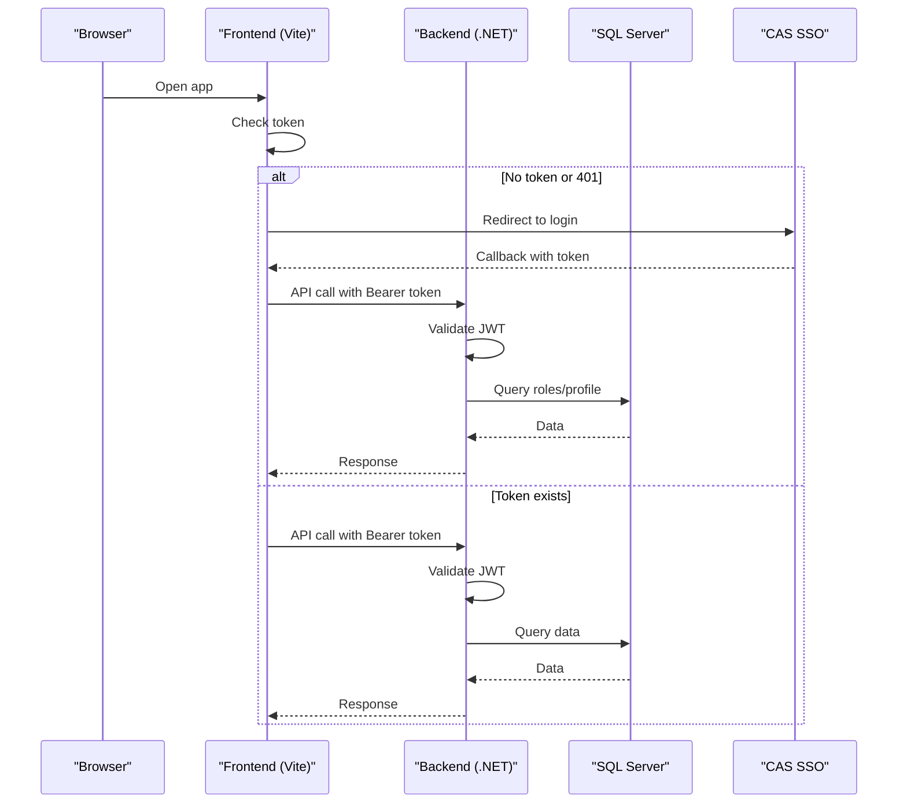
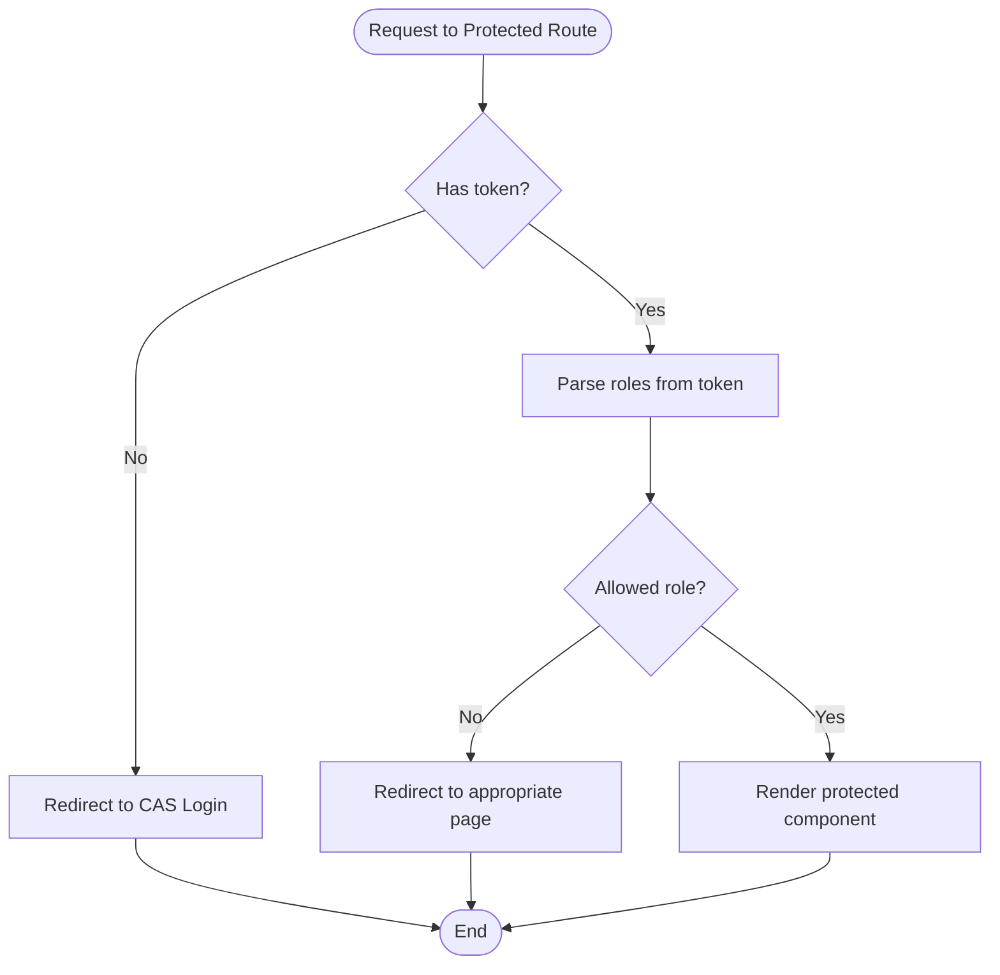
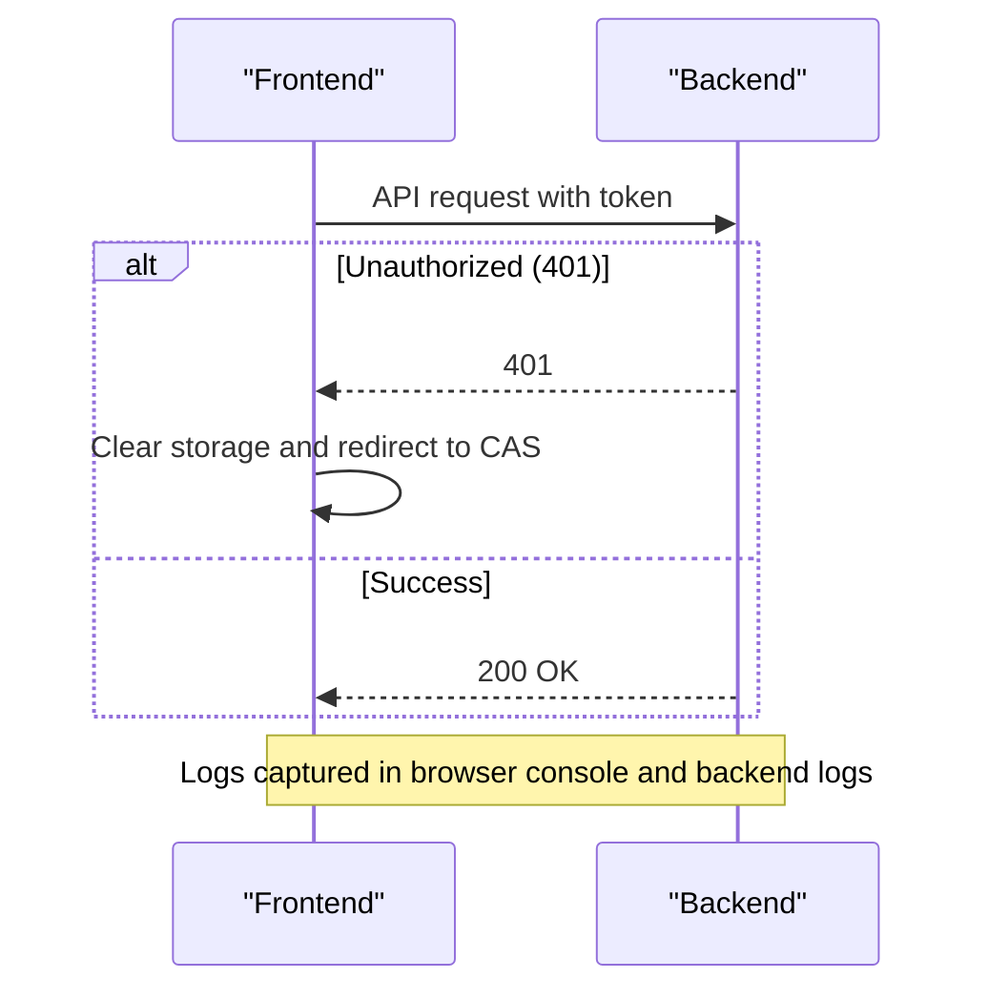
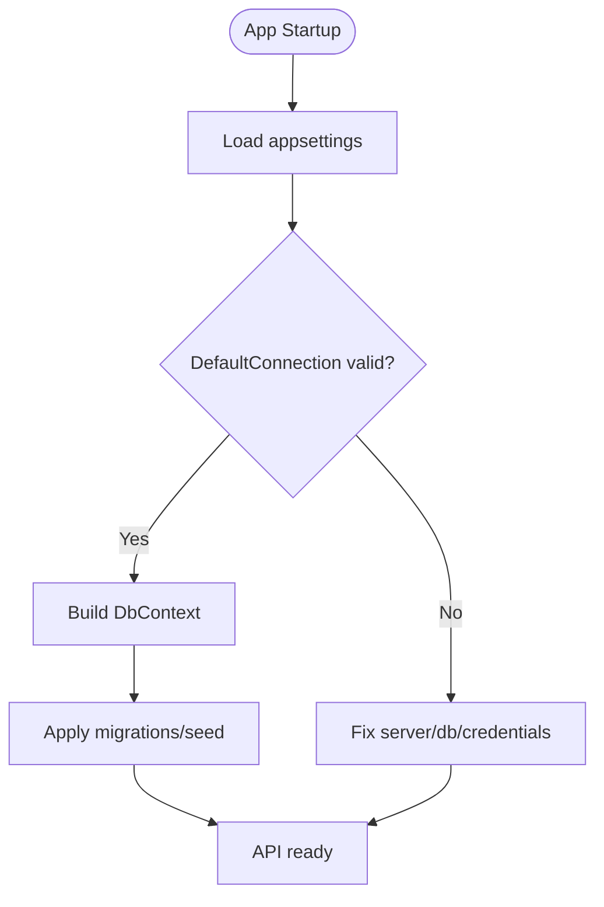
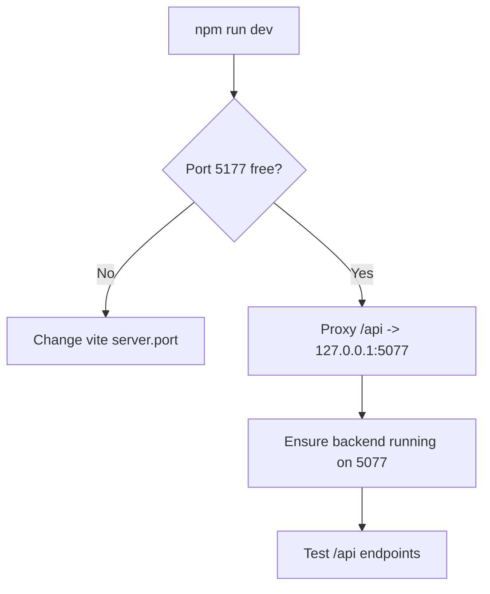
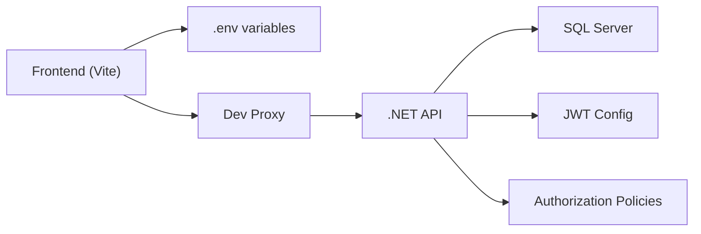

# Troubleshooting & FAQ

<cite>
**Referenced Files in This Document**
- [README.md](file://README.md)
- [client/README.md](file://client/README.md)
- [client/vite.config.js](file://client/vite.config.js)
- [client/setupproxy.js](file://client/setupproxy.js)
- [client/src/api/axios.js](file://client/src/api/axios.js)
- [client/src/components/ProtectedRoute.jsx](file://client/src/components/ProtectedRoute.jsx)
- [client/src/pages/LoginPage.jsx](file://client/src/pages/LoginPage.jsx)
- [server/Api/appsettings.json](file://server/Api/appsettings.json)
- [server/Api/appsettings.Development.json](file://server/Api/appsettings.Development.json)
- [server/Api/appsettings.Production.json](file://server/Api/appsettings.Production.json)
- [server/Api/Program.cs](file://server/Api/Program.cs)
- [server/Api/Controllers/AuthController.cs](file://server/Api/Controllers/AuthController.cs)
</cite>

## Table of Contents
1. Introduction
2. Project Structure
3. Core Components
4. Architecture Overview
5. Detailed Component Analysis
6. Dependency Analysis
7. Performance Considerations
8. Troubleshooting Guide
9. Conclusion
10. Appendices

## Introduction
This document provides comprehensive troubleshooting and frequently asked questions for the Exam-Hub application across development, testing, and production environments. It focuses on common setup issues, authentication flows, database connectivity, API errors, browser compatibility, and performance profiling. It includes step-by-step resolution procedures, diagnostic commands, configuration validation steps, and environment verification procedures to help developers and operators maintain a stable system.

## Project Structure
Exam-Hub is a monorepo with:
- Client: React + Vite frontend
- Server: .NET Core API backend

Key entry points and configurations:
- Frontend dev server runs on port 5177 by default and proxies /api requests to the backend during development.
- Backend uses ASP.NET Core with JWT-based authentication, Entity Framework SQL Server context, and Swagger in development.

**Diagram sources**
- [client/vite.config.js:5-11](file://client/vite.config.js#L5-L11)
- [client/setupproxy.js:1-17](file://client/setupproxy.js#L1-L17)
- [client/src/api/axios.js:1-62](file://client/src/api/axios.js#L1-L62)
- [client/src/components/ProtectedRoute.jsx:1-90](file://client/src/components/ProtectedRoute.jsx#L1-L90)
- [client/src/pages/LoginPage.jsx:1-76](file://client/src/pages/LoginPage.jsx#L1-L76)
- [server/Api/Program.cs:17-146](file://server/Api/Program.cs#L17-L146)
- [server/Api/Controllers/AuthController.cs:118-313](file://server/Api/Controllers/AuthController.cs#L118-L313)
- [server/Api/appsettings.json:1-18](file://server/Api/appsettings.json#L1-L18)
- [server/Api/appsettings.Development.json:1-12](file://server/Api/appsettings.Development.json#L1-L12)
- [server/Api/appsettings.Production.json:1-11](file://server/Api/appsettings.Production.json#L1-L11)

**Section sources**
- [README.md:5-23](file://README.md#L5-L23)
- [client/README.md:1-13](file://client/README.md#L1-L13)

## Core Components
- Authentication:
  - Frontend redirects unauthenticated users to CAS SSO and handles 401 responses by redirecting back to login.
  - Backend validates JWT tokens, maps roles, and enforces authorization policies.
- Database:
  - SQL Server via Entity Framework; connection strings configured per environment.
- API:
  - REST endpoints under Controllers; Swagger enabled in development.
- Proxy:
  - Development proxy forwards /api to backend URL.

**Section sources**
- [client/src/api/axios.js:12-57](file://client/src/api/axios.js#L12-L57)
- [client/src/components/ProtectedRoute.jsx:5-89](file://client/src/components/ProtectedRoute.jsx#L5-L89)
- [client/src/pages/LoginPage.jsx:9-28](file://client/src/pages/LoginPage.jsx#L9-L28)
- [server/Api/Program.cs:43-107](file://server/Api/Program.cs#L43-L107)
- [server/Api/Controllers/AuthController.cs:118-313](file://server/Api/Controllers/AuthController.cs#L118-L313)
- [server/Api/appsettings.json:1-18](file://server/Api/appsettings.json#L1-L18)

## Architecture Overview
The application uses CAS Single Sign-On for user authentication. The frontend redirects to CAS when no token is present or when receiving 401 from the backend. The backend validates JWTs issued by CAS and enforces role-based access control.

**Diagram sources**
- [client/src/components/ProtectedRoute.jsx:5-28](file://client/src/components/ProtectedRoute.jsx#L5-L28)
- [client/src/api/axios.js:12-57](file://client/src/api/axios.js#L12-L57)
- [client/src/pages/LoginPage.jsx:9-28](file://client/src/pages/LoginPage.jsx#L9-L28)
- [server/Api/Program.cs:43-107](file://server/Api/Program.cs#L43-L107)
- [server/Api/Controllers/AuthController.cs:381-420](file://server/Api/Controllers/AuthController.cs#L381-L420)

## Detailed Component Analysis

### Authentication Flow (Frontend + Backend)
- Frontend:
  - ProtectedRoute checks for token; if missing, redirects to CAS login.
  - Axios interceptor adds Authorization header and handles 401 by clearing storage and redirecting to CAS.
- Backend:
  - JWT bearer authentication configured with issuer, audience, signing key.
  - Role mapping ensures claims are recognized for authorization policies.
  - AuthController generates tokens for local login and SSO flows.

**Diagram sources**
- [client/src/components/ProtectedRoute.jsx:5-89](file://client/src/components/ProtectedRoute.jsx#L5-L89)
- [client/src/api/axios.js:12-57](file://client/src/api/axios.js#L12-L57)
- [server/Api/Program.cs:43-107](file://server/Api/Program.cs#L43-L107)
- [server/Api/Controllers/AuthController.cs:118-313](file://server/Api/Controllers/AuthController.cs#L118-L313)

**Section sources**
- [client/src/components/ProtectedRoute.jsx:5-89](file://client/src/components/ProtectedRoute.jsx#L5-L89)
- [client/src/api/axios.js:12-57](file://client/src/api/axios.js#L12-L57)
- [client/src/pages/LoginPage.jsx:9-28](file://client/src/pages/LoginPage.jsx#L9-L28)
- [server/Api/Program.cs:43-107](file://server/Api/Program.cs#L43-L107)
- [server/Api/Controllers/AuthController.cs:118-313](file://server/Api/Controllers/AuthController.cs#L118-L313)

### API Error Handling and Logging
- Frontend:
  - Axios response interceptor logs detailed error info and handles unauthorized scenarios.
- Backend:
  - Controllers log attempts and errors; returns standardized error payloads.

**Diagram sources**
- [client/src/api/axios.js:29-57](file://client/src/api/axios.js#L29-L57)
- [server/Api/Controllers/AuthController.cs:118-249](file://server/Api/Controllers/AuthController.cs#L118-L249)

**Section sources**
- [client/src/api/axios.js:29-57](file://client/src/api/axios.js#L29-L57)
- [server/Api/Controllers/AuthController.cs:118-249](file://server/Api/Controllers/AuthController.cs#L118-L249)

### Database Connectivity and Configuration
- Connection strings are defined per environment.
- Backend configures EF Core context using the DefaultConnection string.
- Ensure correct server name, database, credentials, and encryption settings.

**Diagram sources**
- [server/Api/appsettings.json:1-18](file://server/Api/appsettings.json#L1-L18)
- [server/Api/appsettings.Development.json:1-12](file://server/Api/appsettings.Development.json#L1-L12)
- [server/Api/appsettings.Production.json:1-11](file://server/Api/appsettings.Production.json#L1-L11)
- [server/Api/Program.cs:30-33](file://server/Api/Program.cs#L30-L33)

**Section sources**
- [server/Api/appsettings.json:1-18](file://server/Api/appsettings.json#L1-L18)
- [server/Api/appsettings.Development.json:1-12](file://server/Api/appsettings.Development.json#L1-L12)
- [server/Api/appsettings.Production.json:1-11](file://server/Api/appsettings.Production.json#L1-L11)
- [server/Api/Program.cs:30-33](file://server/Api/Program.cs#L30-L33)

### Development Proxy and Ports
- Frontend dev server runs on port 5177 and proxies /api to backend at http://127.0.0.1:5077.
- Ensure backend is running on the expected port and CORS allows the frontend origin.

**Diagram sources**
- [client/vite.config.js:5-11](file://client/vite.config.js#L5-L11)
- [client/setupproxy.js:1-17](file://client/setupproxy.js#L1-L17)

**Section sources**
- [client/vite.config.js:5-11](file://client/vite.config.js#L5-L11)
- [client/setupproxy.js:1-17](file://client/setupproxy.js#L1-L17)

## Dependency Analysis
- Frontend depends on:
  - Environment variables for API base URL and CAS URL.
  - Local proxy for development to reach backend.
- Backend depends on:
  - SQL Server via EF Core.
  - JWT configuration for authentication.
  - Role-based authorization policies.

**Diagram sources**
- [client/src/api/axios.js:7-10](file://client/src/api/axios.js#L7-L10)
- [client/setupproxy.js:1-17](file://client/setupproxy.js#L1-L17)
- [server/Api/Program.cs:30-107](file://server/Api/Program.cs#L30-L107)
- [server/Api/appsettings.json:1-18](file://server/Api/appsettings.json#L1-L18)

**Section sources**
- [client/src/api/axios.js:7-10](file://client/src/api/axios.js#L7-L10)
- [client/setupproxy.js:1-17](file://client/setupproxy.js#L1-L17)
- [server/Api/Program.cs:30-107](file://server/Api/Program.cs#L30-L107)
- [server/Api/appsettings.json:1-18](file://server/Api/appsettings.json#L1-L18)

## Performance Considerations
- Use memory cache where appropriate to reduce repeated queries.
- Profile slow endpoints using backend logging and database query analysis.
- In production, ensure proper CORS and HTTPS redirection are configured.
- Monitor frontend network requests and consider caching strategies for static assets.

[No sources needed since this section provides general guidance]

## Troubleshooting Guide

### Setup and Environment Verification
- Verify prerequisites:
  - .NET SDK installed and accessible.
  - Node.js and npm installed and accessible.
- Confirm ports:
  - Frontend dev server on port 5177 (configurable).
  - Backend listening on expected port (development proxy targets 5077).
- Validate environment variables:
  - Frontend: VITE_API_BASE_URL and VITE_CAS_URL set appropriately for environment.
  - Backend: appsettings files contain correct connection strings and JWT settings.

Diagnostic steps:
- Run frontend dev server and check console for proxy messages.
- Access Swagger UI in development to verify API availability.
- Ping backend health endpoints if available.

**Section sources**
- [README.md:26-54](file://README.md#L26-L54)
- [client/vite.config.js:5-11](file://client/vite.config.js#L5-L11)
- [client/setupproxy.js:1-17](file://client/setupproxy.js#L1-L17)
- [server/Api/appsettings.json:1-18](file://server/Api/appsettings.json#L1-L18)

### Authentication Issues
Symptoms:
- Immediate redirect to CAS login.
- Repeated 401 errors after login.
- Roles not recognized in protected routes.

Resolution steps:
- Ensure token is stored and sent with requests.
- Verify CAS callback URL matches frontend origin.
- Confirm backend JWT issuer, audience, and signing key match CAS configuration.
- Check role mapping in JWT and authorization policies.

Diagnostics:
- Inspect browser storage for token presence.
- Check network tab for Authorization header.
- Review backend logs for JWT validation errors.

**Section sources**
- [client/src/components/ProtectedRoute.jsx:5-28](file://client/src/components/ProtectedRoute.jsx#L5-L28)
- [client/src/api/axios.js:12-57](file://client/src/api/axios.js#L12-L57)
- [server/Api/Program.cs:43-107](file://server/Api/Program.cs#L43-L107)
- [server/Api/Controllers/AuthController.cs:381-420](file://server/Api/Controllers/AuthController.cs#L381-L420)

### Database Connectivity Problems
Symptoms:
- Backend fails to start due to connection errors.
- API endpoints return 500 errors related to database access.

Resolution steps:
- Validate connection string parameters: server, database, user id, password, encryption setting.
- Ensure SQL Server is reachable and accepts connections.
- Apply migrations and seed data if necessary.

Diagnostics:
- Check backend logs for EF Core exceptions.
- Test connection string using a database client tool.
- Verify firewall rules and network accessibility.

**Section sources**
- [server/Api/appsettings.json:1-18](file://server/Api/appsettings.json#L1-L18)
- [server/Api/appsettings.Development.json:1-12](file://server/Api/appsettings.Development.json#L1-L12)
- [server/Api/appsettings.Production.json:1-11](file://server/Api/appsettings.Production.json#L1-L11)
- [server/Api/Program.cs:30-33](file://server/Api/Program.cs#L30-L33)

### API Errors
Symptoms:
- Unexpected 4xx/5xx responses.
- Missing or incorrect payload.

Resolution steps:
- Validate request payloads against controller expectations.
- Check CORS configuration for cross-origin requests.
- Review backend logs for stack traces and error details.

Diagnostics:
- Use Swagger UI to test endpoints directly.
- Inspect browser network tab for request/response details.
- Enable verbose logging in development.

**Section sources**
- [server/Api/Controllers/AuthController.cs:118-249](file://server/Api/Controllers/AuthController.cs#L118-L249)
- [server/Api/Program.cs:92-107](file://server/Api/Program.cs#L92-L107)

### Browser Compatibility Issues
Symptoms:
- Features not working in certain browsers.
- Polyfills or APIs unavailable.

Resolution steps:
- Ensure modern browser support aligned with Vite defaults.
- Add polyfills if targeting older browsers.
- Test across major browsers and devices.

Diagnostics:
- Use browser developer tools to identify unsupported features.
- Check console for runtime errors.

[No sources needed since this section provides general guidance]

### Debugging Techniques
Frontend:
- Use browser console to inspect axios interceptors and network requests.
- Log token presence and headers before each request.
- Validate environment variables loaded at runtime.

Backend:
- Enable Swagger UI in development to explore endpoints.
- Review structured logs for authentication and database operations.
- Use breakpoints in controllers to trace execution flow.

**Section sources**
- [client/src/api/axios.js:12-57](file://client/src/api/axios.js#L12-L57)
- [server/Api/Program.cs:112-116](file://server/Api/Program.cs#L112-L116)
- [server/Api/Controllers/AuthController.cs:118-249](file://server/Api/Controllers/AuthController.cs#L118-L249)

### Log Analysis Strategies
- Frontend:
  - Capture console errors and network failures.
  - Export logs from browser storage for offline analysis.
- Backend:
  - Collect application logs around authentication and database interactions.
  - Correlate timestamps between frontend and backend logs.

**Section sources**
- [client/src/api/axios.js:47-54](file://client/src/api/axios.js#L47-L54)
- [server/Api/Controllers/AuthController.cs:118-249](file://server/Api/Controllers/AuthController.cs#L118-L249)

### Performance Profiling Tools
- Frontend:
  - Use browser performance profiler to analyze rendering and network bottlenecks.
  - Measure API response times and optimize caching.
- Backend:
  - Use logging to identify slow endpoints.
  - Profile database queries and add indexes if necessary.

[No sources needed since this section provides general guidance]

### Diagnostic Commands
- Frontend:
  - Run development server: npm run dev
  - Check proxy logs in console for target URL and environment.
- Backend:
  - Restore dependencies and run: dotnet restore && dotnet run
  - Access Swagger UI at development endpoint to validate API.

**Section sources**
- [README.md:39-54](file://README.md#L39-L54)
- [client/setupproxy.js:1-17](file://client/setupproxy.js#L1-L17)

### Configuration Validation Steps
- Frontend:
  - Verify VITE_API_BASE_URL points to correct backend or proxy.
  - Verify VITE_CAS_URL points to CAS server.
- Backend:
  - Validate connection strings in appsettings per environment.
  - Ensure JWT Key, Issuer, and Audience are correctly set.

**Section sources**
- [client/src/api/axios.js:7-10](file://client/src/api/axios.js#L7-L10)
- [server/Api/appsettings.json:1-18](file://server/Api/appsettings.json#L1-L18)
- [server/Api/appsettings.Development.json:1-12](file://server/Api/appsettings.Development.json#L1-L12)
- [server/Api/appsettings.Production.json:1-11](file://server/Api/appsettings.Production.json#L1-L11)

### Frequently Asked Questions
- What are the system requirements?
  - .NET SDK and Node.js/npm are required for development and deployment.
- How do I configure the frontend to use the backend in production?
  - Set VITE_API_BASE_URL to the production API base URL.
- Why am I redirected to CAS repeatedly?
  - Ensure token is stored and sent; verify CAS callback URL and backend JWT configuration.
- Can I disable CORS in development?
  - CORS is allowed for all origins in development; restrict in production to trusted origins.
- How do I handle role mismatches?
  - Ensure roles are included in JWT and mapped correctly; verify authorization policies.

**Section sources**
- [README.md:26-54](file://README.md#L26-L54)
- [client/src/api/axios.js:7-10](file://client/src/api/axios.js#L7-L10)
- [client/src/components/ProtectedRoute.jsx:5-89](file://client/src/components/ProtectedRoute.jsx#L5-L89)
- [server/Api/Program.cs:92-107](file://server/Api/Program.cs#L92-L107)

## Conclusion
This guide consolidates common issues and resolutions for Exam-Hub across setup, authentication, database connectivity, API errors, and performance considerations. By following the diagnostic steps, configuration validations, and best practices outlined here, teams can efficiently troubleshoot and maintain the application in development, testing, and production environments.

[No sources needed since this section summarizes without analyzing specific files]

## Appendices
- Quick reference for ports and URLs:
  - Frontend dev server: port 5177 (configurable)
  - Backend proxy target: http://127.0.0.1:5077
  - Swagger UI: enabled in development
- Environment variables:
  - VITE_API_BASE_URL: API base URL
  - VITE_CAS_URL: CAS login URL

[No sources needed since this section provides general guidance]