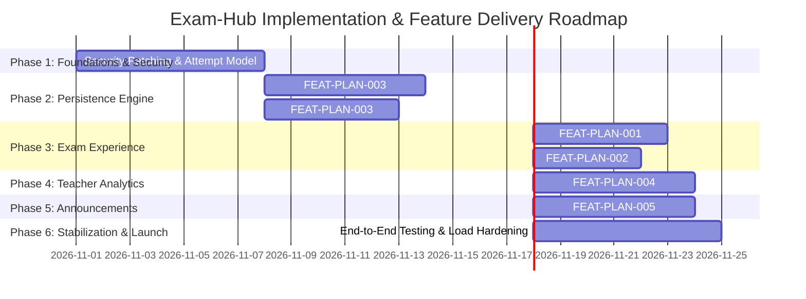

# Exam-Hub — Feature Implementation Roadmap & Delivery Plan

**Project:** Exam-Hub Examination Management Platform  
**Target Organization:** Elsewedy International School for Applied Technology  
**Document Reference:** ETH-ROADMAP-2026-V1  
**Author:** Senior Software Architect & Lead Auditor  
**Date:** October 2026  
**Status:** Approved Engineering Execution Plan  

---

## 1. Executive Roadmap Summary

This document establishes a practical, risk-managed engineering roadmap for implementing the five planned features and resolving the critical architectural prerequisites discovered during the codebase audit of **Exam-Hub**.

### Key Planning Principles:
1. **Security & Data Integrity Precede New Features:** Implementing autosave or server-side timers on top of the current schema will fail because the existing submission endpoint immediately rejects duplicate answer writes. Security vulnerabilities (such as question answers leaking in student payloads) must be sealed first.
2. **Effort vs. Duration Clarity:**
   - **Developer-Days (Dev-Days):** Actual engineering effort required by one developer working without interruption.
   - **Calendar Days (Elapsed Days):** Real-world project duration accounting for code reviews, database migrations, cross-team coordination, QA cycles, and release testing.
3. **Phased Delivery:** Grouped into 6 sequential phases spanning approximately 6 to 8 calendar weeks for a team of 2 Full-Stack Engineers and 1 QA/Security Specialist.

---

## 2. High-Level Release Timeline

---

## 3. Detailed Phase Specifications

---

### Phase 1 — Security Hardening & Data Model Foundations

#### Objective:
Eliminate critical security vulnerabilities and establish the relational schema prerequisites required by the upcoming student features.

#### Tasks:
- **TASK-1.1:** Critical Security Patch — Strip `CorrectAnswer` from student-facing endpoints (`GET /api/ExamDetail/{id}` and `GET /api/StudentExamAnswer/...`). Create separate `QuestionStudentDto` and `QuestionTeacherDto`.
- **TASK-1.2:** Implement Authentication & Policy Enforcement on `ExamDetailController` and `QuestionBankController` (close anonymous access).
- **TASK-1.3:** Database Migration — Create `ExamAttempt` table to track session lifecycle (`StartedAt`, `ServerDeadline`, `SubmittedAt`, `Status`).
- **TASK-1.4:** Database Migration — Refactor `Exam_Details.ClassId` from comma-separated string to normalized `Exam_Class` junction table.
- **TASK-1.5:** Map missing EF Core navigation properties on `ExamQuestionBank` and `ExamDetail`.

#### Dependencies:
- Approval of database migration scripts.
- SQL Server schema backup.

#### Estimated Effort:
- **Effort:** 5 – 7 Developer-Days.
- **Calendar Duration:** 7 – 9 Days (1.5 Sprints).

#### Deliverables:
- EF Core Migration files (`AddExamAttemptTable`, `NormalizeExamClassJunction`).
- Hardened `ExamDetailController` and `StudentExamAnswerController`.
- Secure DTO separation preventing answer leakage.

#### Acceptance Criteria:
- Inspecting browser Network tab during an active exam reveals zero instances of `correctAnswer`.
- Attempting unauthenticated HTTP requests to `/api/ExamDetail` or `/api/QuestionBank` returns HTTP 401 Unauthorized.
- `ExamAttempt` records can be created and queried without relational errors.

#### Testing Requirements:
- Automated API integration tests verifying role access and payload sanitization.

---

### Phase 2 — Draft Persistence & Automatic Answer Saving (FEAT-PLAN-003)

#### Objective:
Implement a resilient, server-authoritative autosave mechanism preventing student data loss during examinations.

#### Tasks:
- **TASK-2.1:** Backend — Add `IsDraft` and `LastSavedAt` columns to `StudentExamAnswer` (or create `StudentExamAnswerDraft` table).
- **TASK-2.2:** Backend — Implement `POST /api/ExamAttempt/{id}/save-draft` endpoint with debounced batch upsert logic.
- **TASK-2.3:** Backend — Implement `GET /api/ExamAttempt/{id}/drafts` to allow draft recovery upon reconnection.
- **TASK-2.4:** Frontend — Convert `QuizInterface.jsx` inputs to trigger debounced autosave events (1.5-second idle threshold).
- **TASK-2.5:** Frontend — Add network awareness (`navigator.onLine`), local storage fallback queue, and visual status indicator (🟢 *Saved*, 🟡 *Saving...*, 🔴 *Offline*).
- **TASK-2.6:** Frontend — Implement automatic answer restoration on page load.

#### Dependencies:
- Phase 1 `ExamAttempt` entity.

#### Estimated Effort:
- **Effort:** 6 – 9 Developer-Days.
- **Calendar Duration:** 8 – 11 Days.

#### Deliverables:
- Draft saving endpoints and repository methods.
- Resilient client-side autosave sync engine in `QuizInterface.jsx`.
- Visual autosave status component.

#### Acceptance Criteria:
- Selecting an answer updates the server within 2 seconds.
- Refreshing the browser or navigating away does not discard previously entered answers.
- Disconnecting Wi-Fi preserves answers in local device storage; reconnecting automatically synchronizes drafts to the server.
- Calling `POST /submit` finalizes the attempt and transitions all drafts into authoritative graded answers.

#### Testing Requirements:
- Network drop simulation tests via Chrome DevTools throttling.
- Concurrent stress testing of autosave endpoints (simulating 200 simultaneous student keystrokes).

---

### Phase 3 — Student Exam Integrity & Review (FEAT-PLAN-001 & FEAT-PLAN-002)

#### Objective:
Deploy server-enforced exam timers, automated submission, question review flagging, and an interactive question navigator.

#### Tasks:
- **TASK-3.1:** Backend — Add `DurationMinutes` to `ExamDetail` and enforce server deadline validation during answer submission (`FEAT-PLAN-001`).
- **TASK-3.2:** Frontend — Implement drift-corrected countdown timer in `QuizInterface.jsx` synchronized with server UTC time (`FEAT-PLAN-001`).
- **TASK-3.3:** Frontend — Implement automatic client submission trigger on timer expiration (`FEAT-PLAN-001`).
- **TASK-3.4:** Frontend — Create `QuestionNavigator.jsx` component rendering an interactive question number grid (`FEAT-PLAN-002`).
- **TASK-3.5:** Frontend — Add "Mark for Review" button to question cards, linking review state to the navigator badges (`FEAT-PLAN-002`).
- **TASK-3.6:** Frontend — Add pre-submission modal showing unanswered and flagged question tallies (`FEAT-PLAN-002`).

#### Dependencies:
- Phase 2 Draft Persistence (prerequisite for safe auto-submission).

#### Estimated Effort:
- **Effort:** 6 – 9 Developer-Days (FEAT-PLAN-001: 4–6 days, FEAT-PLAN-002: 2–3 days).
- **Calendar Duration:** 8 – 10 Days.

#### Deliverables:
- Server-validated timer mechanism.
- Question Navigator sidebar/drawer component.
- Question review badge system.

#### Acceptance Criteria:
- Client countdown matches server deadline regardless of local computer clock alterations.
- When timer reaches 00:00, all inputs lock and submission fires automatically.
- Submissions received after server deadline + grace period are rejected by the API.
- Clicking question numbers in the navigator smoothly scrolls the viewport to that question.
- Flagged questions are clearly badged in the navigator and reported in the pre-submission confirmation dialog.

#### Testing Requirements:
- Time manipulation tests (advancing OS clock to ensure server deadline controls expiration).
- End-to-end exam lifecycle tests with flagging, timing out, and auto-submitting.

---

### Phase 4 — Teacher Analytics & Question Performance (FEAT-PLAN-004)

#### Objective:
Equip educators with psychometric item analysis and question-level difficulty diagnostics.

#### Tasks:
- **TASK-4.1:** Backend — Create `QuestionPerformanceDto` and aggregation repository query computing total attempts, correct count, incorrect count, and accuracy percentages.
- **TASK-4.2:** Backend — Implement distractor frequency analysis (counting frequency of selected options A, B, C, D).
- **TASK-4.3:** Backend — Expose `GET /api/Dashboard/exam/{id}/question-analytics` with teacher ownership authorization.
- **TASK-4.4:** Backend — Add SQL index on `StudentExamAnswer(ExamDetailsID, QuestionBankID)` and configure 5-minute memory caching.
- **TASK-4.5:** Frontend — Create `QuestionAnalyticsView.jsx` in `TeacherPage.jsx` with summary cards, sortable table, and distractor bar charts.

#### Dependencies:
- Phase 1 normalized exam questions and submissions.

#### Estimated Effort:
- **Effort:** 4 – 6 Developer-Days.
- **Calendar Duration:** 6 – 8 Days.

#### Deliverables:
- High-performance aggregation SQL queries and API endpoints.
- Interactive question analytics dashboard for teachers.
- Distractor breakdown visualizations.

#### Acceptance Criteria:
- Teachers can view question-level accuracy percentages for any of their exams.
- The UI highlights questions with an accuracy below 30% ("Difficult / Review Needed") or above 90% ("Very Easy").
- Distractor charts accurately show the proportion of students selecting each multiple-choice option.
- Queries execute in under 300ms for exams with up to 1,000 students.

#### Testing Requirements:
- Mathematical accuracy unit tests verifying percentage denominators and null-handling.
- Security tests ensuring teachers cannot access exam analytics outside their department.

---

### Phase 5 — Administrator Announcements (FEAT-PLAN-005)

#### Objective:
Deliver a targeted communications module allowing administrators to broadcast notices across roles and academic levels.

#### Tasks:
- **TASK-5.1:** Database Migration — Create `Announcement` and `AnnouncementReadReceipt` tables.
- **TASK-5.2:** Backend — Implement `AnnouncementController` (`POST`, `PUT`, `DELETE` for Admins; `GET /feed` for all authenticated users).
- **TASK-5.3:** Backend — Implement audience targeting logic filtering by Role, Grade, and Class.
- **TASK-5.4:** Frontend — Build Announcement Management tab in `SuperAdminPage.jsx` (rich text editor, audience picker, expiration date).
- **TASK-5.5:** Frontend — Add Notification Bell icon with unread count badge and slide-out panel to Student and Teacher navigation headers.

#### Dependencies:
- User, Role, and Grade database tables.

#### Estimated Effort:
- **Effort:** 5 – 7 Developer-Days.
- **Calendar Duration:** 7 – 9 Days.

#### Deliverables:
- Announcement CRUD and delivery APIs.
- Admin creation and targeting interface.
- Student and Teacher notification bell and feed.

#### Acceptance Criteria:
- An announcement targeted to "Senior Grade" is visible only to Senior students and invisible to Junior students.
- An announcement targeted to "Teachers" is invisible to students.
- Unread count badge decrements when a user opens and marks an announcement as read.
- Expired announcements automatically drop out of user feeds.

#### Testing Requirements:
- Multi-role permission and audience filtering test suite.
- HTML input sanitization tests preventing XSS injection.

---

### Phase 6 — Integration, Load Testing & Production Stabilization

#### Objective:
Conduct end-to-end regression testing, high-concurrency load testing, and security penetration audits prior to school-wide deployment.

#### Tasks:
- **TASK-6.1:** Load Testing — Simulate 500 concurrent students performing simultaneous exam starts, autosaves, and submissions using k6 or JMeter.
- **TASK-6.2:** Database Performance Tuning — Monitor SQL Server query execution plans and adjust indexes.
- **TASK-6.3:** End-to-End User Acceptance Testing (UAT) with teachers and students.
- **TASK-6.4:** Deployment Documentation & Operations Playbook update.

#### Dependencies:
- Completion of Phases 1 through 5.

#### Estimated Effort:
- **Effort:** 4 – 6 Developer-Days.
- **Calendar Duration:** 6 – 8 Days.

#### Deliverables:
- Load test benchmark report.
- Production deployment checklist and rollback plan.
- Verified stable build.

---

## 4. Resource Allocation & Team Assumptions

| Role | Capacity | Primary Responsibilities |
|---|---|---|
| **Full-Stack Engineer 1 (Backend Lead)** | 100% | Database migrations, EF Core mappings, Core APIs, Autosave engine, Analytics aggregations. |
| **Full-Stack Engineer 2 (Frontend Lead)** | 100% | React components, QuizInterface refactoring, Question Navigator, Timer, Notification UI. |
| **QA / Security Engineer** | 50% | Automated integration test suite, load testing, security regression audits. |

### Key Project Assumptions:
- Staging environment with identical SQL Server configuration is available for load testing.
- No third-party breaking API dependencies.
- Work is executed in standard 2-week agile sprints.

---
*End of Feature Implementation Roadmap.*
