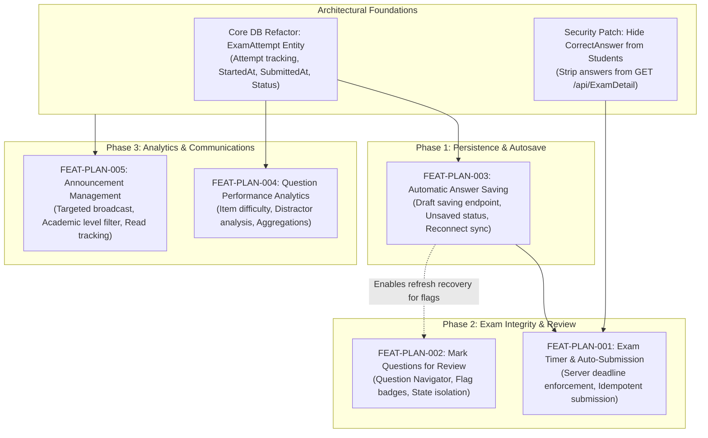

# Exam-Hub — Planned Feature Feasibility & Technical Analysis Report

**Document Reference:** ETH-FEAT-2026-V1  
**Project:** Exam-Hub (Examination Management Platform)  
**Organization:** Elsewedy International School for Applied Technology  
**Author:** Senior Software Architect & Security Auditor  
**Date:** October 2026  
**Status:** Architecture Planning & Feasibility Assessment  

---

## Executive Overview

This report provides an in-depth reverse engineering and feasibility analysis for the five planned features requested by the Exam-Hub product and academic stakeholders:

1. **FEAT-PLAN-001:** Exam Timer & Auto-Submission (Student)
2. **FEAT-PLAN-002:** Mark Questions for Review (Student)
3. **FEAT-PLAN-003:** Automatic Answer Saving (Student)
4. **FEAT-PLAN-004:** Question Performance Analytics (Teacher)
5. **FEAT-PLAN-005:** Announcement Management (Administrator)

Every feature has been audited against the actual code in the repository (`server/Api` and `client/src`). This report outlines verified current-state capabilities, architectural gaps, concrete database schema designs, backend service implementations, API modifications, frontend interfaces, security considerations, and effort estimates.

---

## Planned Feature Summary Table

| Feature ID | Feature Name | User Role | Current Status | Dependencies | Complexity | Estimated Effort |
|---|---|---|---|---|---|---|
| **FEAT-PLAN-001** | Exam Timer & Auto-Submission | Student | **Partially Implemented (Client-Only / Vulnerable)** | FEAT-PLAN-003 (Draft Persistence), Database Attempt Model | Medium | 4 – 6 Developer-Days |
| **FEAT-PLAN-002** | Mark Questions for Review | Student | **Not Implemented** | FEAT-PLAN-003 (Optional for refresh persistence), Navigation UI | Low | 2 – 3 Developer-Days |
| **FEAT-PLAN-003** | Automatic Answer Saving | Student | **Not Implemented (Blocked by Current Schema)** | Core Database Attempt Entity (`ExamAttempt`) | High | 6 – 9 Developer-Days |
| **FEAT-PLAN-004** | Question Performance Analytics | Teacher | **Not Implemented** | Core Answer Submission & Grading Model | Medium | 4 – 6 Developer-Days |
| **FEAT-PLAN-005** | Announcement Management | Administrator | **Not Implemented (Model Exists, Disconnected)** | Target Audience Schema Enhancement | Medium | 5 – 7 Developer-Days |

*Total Estimated Effort Across All 5 Features: 21 – 31 Developer-Days.*

---

## Feature Dependency Analysis



### Dependency Rationale:
1. **FEAT-PLAN-003 is a hard architectural prerequisite for FEAT-PLAN-001:** If an auto-submission timer fires or the browser closes, answers must already exist on the server. Furthermore, the existing backend code in `StudentExamAnswerController.cs` (lines 229–233) contains a check: `if (existingAnswers.Any()) return BadRequest("You have already submitted answers for this exam.");`. In the current database schema, saving intermediate answers immediately locks the student out of submitting. An `ExamAttempt` entity and decoupled draft status must be introduced before autosave or server-side auto-submission can function reliably.
2. **FEAT-PLAN-001 relies on Server Time Enforcement:** The current implementation computes remaining time via `endDate.getTime() - now.getTime()` in `StudentPage.jsx` (line 446). Manipulating the local machine clock bypasses the timer entirely. Server-side session tracking is mandatory.
3. **FEAT-PLAN-002 depends on Question Navigation:** The current `QuizInterface.jsx` renders questions as an unindexed sequential HTML form. Adding review flags requires upgrading the UI to a modern question navigator sidebar/header.
4. **FEAT-PLAN-004 depends on Single-Attempt Accounting:** Accurate percentage denominators require counting unique student attempts rather than raw rows in `StudentExamAnswer`.
5. **FEAT-PLAN-005 depends on Audience Metadata:** While `server/Api/Models/Notification.cs` exists, it only supports point-to-point single-account messaging. It requires schema extension to support roles, grades, and classes.

---

## Detailed Planned Feature Analyses

---

### FEAT-PLAN-001: Exam Timer & Auto-Submission

#### 1. Feature ID & Name
`FEAT-PLAN-001` — Exam Timer & Server-Enforced Auto-Submission.

#### 2. Intended Users & Business Objective
- **Primary Users:** Students.
- **Secondary Users:** Teachers, School Administrators.
- **Business Objective:** Ensure fair and standardized testing conditions by enforcing strict examination time limits, preventing students from exceeding allowed durations, and safeguarding against zero scores caused by sudden session expiration.

#### 3. Verified Current Implementation Status
**Partially Implemented (Client-Only / Vulnerable):**
- In `client/src/pages/StudentPage.jsx` (lines 316–336), a `setInterval` hook decrements `timeRemaining` by 1 every second and triggers `submitExam(true)` when `timeRemaining === 0`.
- In `client/src/pages/StudentPage.jsx` (lines 444–447), `timeRemaining` is calculated as `endDate.getTime() - now.getTime()`.
- In `client/src/components/QuizInterface.jsx` (line 146), `timeRemaining` is rendered via `formatTimerDisplay(timeRemaining)`.
- **Gaps:** 
  1. The backend has zero concept of an active attempt start time or remaining time.
  2. `POST /api/StudentExamAnswer/submit` does not validate whether the submission arrived within the exam time window.
  3. The timer uses the absolute window deadline (`endDate`) instead of the exam's allocated duration (e.g. 60 minutes from student start).
  4. Students can manipulate their computer clock to alter `new Date()`, extending their time indefinitely.
  5. Page refresh or network failure terminates the timer interval and resets `isExamActive` to `false`.

#### 4. Relevant Existing Files & Components
- `client/src/pages/StudentPage.jsx` (lines 316–336, 444–448, 461–566)
- `client/src/components/QuizInterface.jsx` (lines 119–129, 146–148)
- `server/Api/Controllers/StudentExamAnswerController.cs` (lines 199–332)
- `server/Api/Controllers/ExamDetailController.cs` (lines 255–289)
- `server/Api/Models/ExamDetail.cs` (lines 16–18)

#### 5. Existing Reusable APIs & Entities
- `ExamDetail.EndDate`, `ExamDetail.StartDate`.
- `POST /api/StudentExamAnswer/submit` (payload structure and grading logic).

#### 6. Missing Functionality
- `DurationMinutes` column on `Exam_Details` (currently hardcoded or default to 60 in frontend).
- `ExamAttempt` entity in database tracking `StartedAt`, `ServerDeadline`, and `Status`.
- Server-side deadline validation during submission.
- Client-side synchronization with server time (NTP offset calculation).
- Grace period tolerance (e.g. 30–60 seconds) to account for network latency during auto-submission.

#### 7. Proposed Frontend Changes
- Update `QuizInterface.jsx`: Add sticky header countdown timer with visual urgency alerts (turns amber at 5 minutes, pulsing red at 1 minute).
- Update `StudentPage.jsx`:
  - Calculate `timeRemaining` based on `serverDeadline` returned when starting the exam, corrected by server-client time delta.
  - Implement a web worker timer or drift-corrected `requestAnimationFrame`/timestamp comparison instead of naive `setInterval`.
  - When timer hits zero, disable form inputs immediately, trigger visual overlay ("Time expired. Submitting your examination..."), and call submission endpoint.

#### 8. Proposed Backend Changes
- Create `ExamAttemptService` or update `StudentExamAnswerController`:
  - When student loads exam (`GET /api/StudentExamAnswer/student/{id}/exam/{examId}` or dedicated `POST /api/ExamAttempt/start`):
    - Verify current time is between `ExamDetail.StartDate` and `ExamDetail.EndDate`.
    - Check for an existing `ExamAttempt`. If none exists, create one with `StartedAt = DateTime.UtcNow` and `ServerDeadline = Min(ExamDetail.EndDate, DateTime.UtcNow.AddMinutes(exam.DurationMinutes))`.
    - Return `serverDeadline` and `serverTime` in UTC to the client.
  - In `SubmitStudentAnswers`:
    - Fetch active `ExamAttempt`. If `DateTime.UtcNow > attempt.ServerDeadline.AddSeconds(GracePeriodSeconds)`, reject submission with HTTP 403 / 400 (`"Exam time window has expired"`).
    - Mark attempt status as `Submitted`.

#### 9. Proposed Database Changes
```sql
-- Add Duration to Exam_Details
ALTER TABLE Exam_Details ADD DurationMinutes INT NOT NULL DEFAULT 60;

-- Create ExamAttempt Table
CREATE TABLE ExamAttempt (
    Id BIGINT IDENTITY(1,1) PRIMARY KEY,
    ExamId BIGINT NOT NULL CONSTRAINT FK_ExamAttempt_Exam FOREIGN KEY REFERENCES Exam_Details(Exam_ID),
    AccountId BIGINT NOT NULL CONSTRAINT FK_ExamAttempt_Account FOREIGN KEY REFERENCES Account(ID),
    StartedAt DATETIME2 NOT NULL DEFAULT SYSUTCDATETIME(),
    ServerDeadline DATETIME2 NOT NULL,
    SubmittedAt DATETIME2 NULL,
    Status NVARCHAR(20) NOT NULL DEFAULT 'InProgress', -- 'InProgress', 'Submitted', 'AutoSubmitted', 'Expired'
    IpAddress NVARCHAR(45) NULL,
    UserAgent NVARCHAR(255) NULL,
    CONSTRAINT UQ_ExamAttempt_Account_Exam UNIQUE (AccountId, ExamId)
);
```

#### 10. Required or Modified APIs
- `POST /api/ExamAttempt/start`: Initializes attempt, returns question list (without correct answers) and authoritative `serverDeadline`.
- `POST /api/StudentExamAnswer/submit`: Accepts `attemptId`, validates server deadline, saves final answers, grades attempt, updates status to `Submitted` or `AutoSubmitted`.

#### 11. Authentication & Authorization Requirements
- Must enforce `[Authorize(Roles = "Student")]`.
- Account ID must be extracted strictly from `User.FindFirst(ClaimTypes.NameIdentifier)`, not from the request body.

#### 12. Edge Cases & Failure Scenarios
- **Network drop at timer expiration:** Client attempts auto-submit but is offline. System must allow submission once reconnected within a short tolerance window if draft answers were already saved on the server via FEAT-PLAN-003.
- **Clock skew:** Student’s computer is set 3 hours behind. Mitigated by using UTC server time and calculating delta `clientOffset = Date.now() - serverTimeUtc`.
- **Duplicate submission:** Simultaneous manual click and timer auto-submit. Mitigated by database unique constraint and atomic attempt status transition (`UPDATE ExamAttempt SET Status = 'Submitted' WHERE Id = @Id AND Status = 'InProgress'`).

#### 13. Acceptance Criteria
1. The student sees a live countdown timer showing minutes and seconds remaining.
2. The timer accurate reflects `ServerDeadline`, regardless of changes to client computer clock.
3. At `timeRemaining == 0`, all question inputs are immediately locked.
4. The system submits all entered answers automatically without requiring confirmation clicks.
5. Submissions received past `ServerDeadline + GracePeriod` are rejected by the server with an explicit expiration message.
6. Refreshing the browser during an active exam restores the correct remaining time.

#### 14. Testing Strategy
- **Unit Tests:** Verify deadline calculation math, grace period boundary tests, and attempt status state machine.
- **Integration Tests:** Test `POST /submit` with a simulated timestamp past deadline; assert HTTP 400/403 response.
- **E2E Tests:** Set exam duration to 15 seconds; observe countdown, automatic submission trigger, score dialog appearance, and redirection.

#### 15. Implementation Complexity: **Medium**  
#### 16. Estimated Effort: **4 – 6 Developer-Days**  
#### 17. Recommended Implementation Sequence: **Step 2** (Immediately following FEAT-PLAN-003).  
#### 18. Technical Risks & Mitigation
- **Risk:** Rapid timer countdown re-rendering in React causes input stutter or lag.  
  *Mitigation:* Isolate the timer countdown in an independent React memoized component (`ExamTimerHeader`) so question inputs do not re-render every second.

---

### FEAT-PLAN-002: Mark Questions for Review

#### 1. Feature ID & Name
`FEAT-PLAN-002` — Mark Questions for Review & Question Navigator.

#### 2. Intended Users & Business Objective
- **Primary Users:** Students.
- **Business Objective:** Enhance the student examination experience and test-taking performance by allowing students to flag uncertain questions, view an overview of answered/unanswered/flagged questions, and quickly jump to flagged items before final submission.

#### 3. Verified Current Implementation Status
**Not Implemented:**
- Currently, `QuizInterface.jsx` renders questions linearly in a vertical sequence (`currentQuiz.questions.map(...)`).
- There is no question grid, no navigation drawer, no flag state, and no review indicator.
- Questions are identified only by index (`num = index + 1`).

#### 4. Relevant Existing Files & Components
- `client/src/components/QuizInterface.jsx` (lines 30–117, 165–179)
- `client/src/pages/StudentPage.jsx` (lines 389–438)

#### 5. Existing Reusable APIs & Entities
- Question mapping structure in `QuizInterface` (`id`, `question`, `type`, `options`, `marks`).

#### 6. Missing Functionality
- Review state management in React (`flaggedQuestions: Set<number>`).
- Flag toggle button on question card.
- Question Navigator component (numbered grid showing question status: Unanswered, Answered, Flagged).
- Jump-to-question scroll handler.
- Pre-submission summary warning (e.g. "You have 3 flagged questions and 2 unanswered questions. Are you sure you want to submit?").

#### 7. Proposed Frontend Changes
- Create `client/src/components/QuestionNavigator.jsx`:
  - Renders a grid of buttons `[ 1 ] [ 2 ] [ 3* ] ... [ N ]`.
  - Color codes: Grey (unanswered), Blue/Green (answered), Amber with flag icon (marked for review), Bordered (current active question).
  - Clicking a number executes `document.getElementById('question-card-' + index).scrollIntoView({ behavior: 'smooth' })`.
- Update `QuizInterface.jsx`:
  - Add flag button beside question title: `<button type="button" onClick={() => toggleFlag(question.id)} className={isFlagged ? "flag-active" : "flag-inactive"}>🚩 Review Later</button>`.
  - Maintain `flaggedQuestionIds` state in `StudentPage.jsx` or `QuizInterface.jsx`.
- Update Submission Flow:
  - When clicking "Submit Quiz", display confirmation modal detailing:
    - Total Questions: X
    - Answered: Y
    - Flagged for Review: Z
    - Unanswered: W

#### 8. Proposed Backend Changes
- None strictly required for in-memory session flagging.
- Optional persistence: Add `IsFlagged` column to `StudentExamAnswer` draft table to persist flags across devices or browser crashes (see FEAT-PLAN-003).

#### 9. Proposed Database Changes
- *Optional (if server persistence required):*
```sql
ALTER TABLE StudentExamAnswer ADD IsFlagged BIT NOT NULL DEFAULT 0;
```

#### 10. Required or Modified APIs
- None if flags are maintained in client session state.
- If saved with drafts (FEAT-PLAN-003): Include `isFlagged: boolean` inside draft save payload `POST /api/ExamAttempt/save-draft`.

#### 11. Authentication & Authorization Requirements
- Standard student token required.

#### 12. Edge Cases & Failure Scenarios
- **Student marks a question for review and answers it:** Question must show "Answered & Flagged" state (e.g. Green background with an amber flag pin).
- **Submitting with active flags:** Flags must not prevent submission or invalidate answers. They are strictly an advisory study aid.
- **Page refresh:** If flags are in `sessionStorage` (keyed by `exam_${examId}_flags`), they survive accidental browser refresh.

#### 13. Acceptance Criteria
1. Every question card has a clear "Mark for Review" button.
2. Clicking the button toggles flagged state immediately without page lag.
3. The Question Navigator highlights flagged questions with a distinctive badge or color.
4. Clicking any question number in the navigator scrolls directly to that question.
5. The final submit dialog explicitly warns the student if any questions remain flagged.
6. When the exam is submitted, flagged questions are graded normally according to whatever answer was entered.

#### 14. Testing Strategy
- **Unit Tests:** Component test for `QuestionNavigator` ensuring correct CSS class application for answered, unanswered, and flagged states.
- **Interaction Tests:** Verify that clicking flag updates the navigator badge, and clicking the badge triggers smooth scrolling to the target DOM ID.

#### 15. Implementation Complexity: **Low**  
#### 16. Estimated Effort: **2 – 3 Developer-Days**  
#### 17. Recommended Implementation Sequence: **Step 3** (Can be implemented in parallel with FEAT-PLAN-001).  
#### 18. Technical Risks & Mitigation
- **Risk:** Mobile layout distortion if question navigator takes up too much horizontal screen space.  
  *Mitigation:* Implement a collapsible drawer or sticky floating bottom bar for mobile screens.

---

### FEAT-PLAN-003: Automatic Answer Saving

#### 1. Feature ID & Name
`FEAT-PLAN-003` — Resilient Automatic Answer Saving & Session Draft Recovery.

#### 2. Intended Users & Business Objective
- **Primary Users:** Students.
- **Secondary Users:** System Administrators, Exam Proctors.
- **Business Objective:** Prevent student data loss caused by accidental browser closures, page reloads, computer crashes, or transient internet disconnection. Ensure high availability and trust in the digital exam process.

#### 3. Verified Current Implementation Status
**Not Implemented (Architecturally Blocked):**
- In `client/src/pages/StudentPage.jsx` (lines 482–504), answers exist purely in the browser's DOM form (`new FormData(document.getElementById('quiz-form'))`).
- In `client/src/pages/StudentPage.jsx` (line 91), there is a `beforeunload` warning handler, but if the student reloads, `isExamActive` is lost from React state and all answers are erased.
- In `server/Api/Controllers/StudentExamAnswerController.cs` (lines 229–233), line 233 blocks saving if answers already exist:
  `if (existingAnswers.Any()) return BadRequest(new { message = "You have already submitted answers for this exam." });`
- Consequently, calling the existing backend endpoint with intermediate answers makes final submission completely impossible!

#### 4. Relevant Existing Files & Components
- `client/src/pages/StudentPage.jsx` (lines 482–566)
- `client/src/components/QuizInterface.jsx` (lines 60, 85, 107)
- `client/src/utils/storage.js`
- `server/Api/Controllers/StudentExamAnswerController.cs` (lines 199–332)
- `server/Api/Models/StudentExamAnswer.cs` (lines 1–27)

#### 5. Existing Reusable APIs & Entities
- `StudentExamAnswer` table (can be updated to store draft state, or supplemented by `ExamAttemptAnswerDraft`).
- `StudentAnswerSubmitDto` / `AnswerDto` payload structure.

#### 6. Missing Functionality
- Draft state indicator in UI (e.g., "Saving...", "All changes saved", "Offline — saving locally").
- Debounced autosave trigger on radio button click and text input changes.
- Server-side `SaveDraft` endpoint that updates answers without triggering final grading.
- Client-side offline cache (`IndexedDB` or `localStorage`) for temporary fallback during network blackouts.
- Automatic draft restoration on page mount when returning to an in-progress exam.

#### 7. Proposed Frontend Changes
- Update `QuizInterface.jsx`:
  - Convert form controls from uncontrolled inputs to controlled React components or attach an `onChange` listener to the form.
  - Implement a 1000ms debounce hook on input changes.
  - Display an autosave status badge in the header:
    - 🟢 *Saved at 10:14 AM*
    - 🟡 *Saving draft...*
    - 🔴 *Offline — saved on device. Reconnecting...*
- Update `StudentPage.jsx`:
  - On component mount, call `GET /api/ExamAttempt/{attemptId}/drafts`.
  - Pre-populate question inputs with recovered answers.
  - Listen for window `online` / `offline` events; flush pending offline queue when connectivity is restored.

#### 8. Proposed Backend Changes
- Create `ExamAttemptController` and repository methods:
  - `POST /api/ExamAttempt/{attemptId}/save-draft`:
    - Validates attempt is `InProgress` and not expired.
    - Performs an **UPSERT** operation on `StudentExamAnswerDraft` (or `StudentExamAnswer` with `IsDraft = 1`).
    - Returns HTTP 200 with server timestamp.
  - `GET /api/ExamAttempt/{attemptId}/drafts`:
    - Returns all saved draft answers for the active student attempt.
- Modify `POST /api/StudentExamAnswer/submit`:
  - Read from draft answers if submitted payload is empty or partial.
  - Atomically update attempt status to `Submitted`.
  - Grade the answers and set `IsDraft = 0`.

#### 9. Proposed Database Changes
```sql
-- Option A: Add Draft Column to Existing StudentExamAnswer
ALTER TABLE StudentExamAnswer ADD IsDraft BIT NOT NULL DEFAULT 0;
ALTER TABLE StudentExamAnswer ADD LastSavedAt DATETIME2 NOT NULL DEFAULT SYSUTCDATETIME();

-- Drop and recreate unique index to support drafts
DROP INDEX UQ_StudentExamAnswer_AccountExamQuestion ON StudentExamAnswer;
CREATE UNIQUE INDEX UQ_StudentExamAnswer_AccountExamQuestion 
ON StudentExamAnswer(AccountId, ExamDetailsID, QuestionBankID);
```

#### 10. Required or Modified APIs
- `POST /api/ExamAttempt/save-draft`:
  - Body: `{ examId: long, answers: [{ questionId: long, answer: string, isFlagged: bool }] }`
  - Response: `{ success: true, savedAt: DateTime, count: int }`
- `GET /api/ExamAttempt/{examId}/my-draft`:
  - Returns `{ examId, attemptId, answers: [{ questionId, answer, isFlagged, lastSavedAt }] }`

#### 11. Authentication & Authorization Requirements
- Must require `[Authorize(Roles = "Student")]`.
- The server must strictly verify that the draft belongs to the authenticated user ID in the JWT token.

#### 12. Edge Cases & Failure Scenarios
- **Total Wi-Fi Disconnection:** Autosave HTTP requests fail. Client stores answers in `localStorage` under `exam_${examId}_draft`. When network reconnects, client detects online status and immediately pushes the local cache to the server.
- **Race Condition on Submission:** Autosave request in flight while student clicks "Submit Quiz".
  *Mitigation:* Backend uses transaction locks on the attempt record; once attempt is marked `Submitted`, any late-arriving draft request returns HTTP 409 Conflict (`"Exam has already been finalized"`).
- **Multiple Tabs:** Student opens exam in two tabs.
  *Mitigation:* Use BroadcastChannel API or storage event in browser to synchronize active tab, warning the student if multiple tabs are detected.

#### 13. Acceptance Criteria
1. Selecting an option or typing an answer triggers an automatic background save within 1–2 seconds.
2. The user interface clearly displays saving status ("Saving...", "Saved").
3. Closing the browser window or refreshing the page does not lose any saved answers.
4. When the student re-opens the exam, all previously answered questions are restored exactly as left.
5. If the network drops, answers are queued locally and automatically synced once the connection resumes.
6. Draft saving ceases immediately once the exam is submitted or expires.

#### 14. Testing Strategy
- **Unit Tests:** Test debouncing logic and draft payload serialization.
- **Integration Tests:** Execute concurrent draft saves; verify database upsert idempotency and constraint safety.
- **Resilience Tests:** Emulate network disconnect via browser DevTools; input answers; reload page offline; restore connection; verify answers sync to backend.

#### 15. Implementation Complexity: **High**  
#### 16. Estimated Effort: **6 – 9 Developer-Days**  
#### 17. Recommended Implementation Sequence: **Step 1** (Core Foundation for FEAT-PLAN-001 & FEAT-PLAN-002).  
#### 18. Technical Risks & Mitigation
- **Risk:** High-frequency autosave requests from 500 students concurrently taking an exam creates database connection pool exhaustion or high CPU on SQL Server.  
  *Mitigation:* Debounce client requests to minimum 1.5–2.0 seconds; send batched answer arrays rather than per-question requests; use lightweight raw SQL UPSERT (`MERGE` statement) or Dapper instead of heavy EF Core change tracking.

---

### FEAT-PLAN-004: Question Performance Analytics

#### 1. Feature ID & Name
`FEAT-PLAN-004` — Question-Level Performance Analytics & Psychometric Item Analysis.

#### 2. Intended Users & Business Objective
- **Primary Users:** Teachers, Subject Coordinators, Academic Supervisors.
- **Secondary Users:** School Administrators.
- **Business Objective:** Provide educators with actionable psychometric insights into examination quality, identifying questions that are too difficult, too easy, ambiguous, or poorly taught, thereby improving academic curriculum and assessment standards.

#### 3. Verified Current Implementation Status
**Not Implemented:**
- Currently, `DashboardRepo.cs` provides exam-level metrics (`TotalMarks`, `EarnedMarks`, `Score`, `PassRate`, `AverageScore`) and student leaderboards.
- In `TeacherPage.jsx` (lines 1380–2871), tabs exist for `my-quizzes`, `question-banks`, `students`, and `classes`, but **zero** views or charts exist for question-level statistics.
- No endpoint in `DashboardController.cs` or `ExamDetailController.cs` computes or returns question accuracy rates.

#### 4. Relevant Existing Files & Components
- `server/Api/Controllers/DashboardController.cs` (lines 331–352)
- `server/Api/Repositories/Implementation/DashboardRepo.cs` (lines 143–185)
- `server/Api/Models/StudentExamAnswer.cs` (lines 15–19)
- `client/src/pages/TeacherPage.jsx` (lines 2008–2113)
- `client/src/components/DashboardCharts.jsx`

#### 5. Existing Reusable APIs & Entities
- `StudentExamAnswer.Score` (boolean indicating if the answer was correct).
- `StudentExamAnswer.ChoosedAnswer` (records the specific distractor chosen by the student).
- `ExamQuestionBank` (links questions to exams).
- `QuestionBank` (contains question text, options A–H, mark weight).

#### 6. Missing Functionality
- Question performance DTO (`QuestionPerformanceDto` containing TotalAttempts, CorrectCount, IncorrectCount, AccuracyRate, DistractorBreakdown).
- Backend repository method executing grouped aggregation SQL queries.
- Authorization filter restricting teachers to exams for their assigned subjects/classes.
- Frontend Question Analytics tab in `TeacherPage.jsx`.
- Visual distractor distribution chart (e.g. Bar chart showing percentage choosing Option A, B, C, D).

#### 7. Proposed Frontend Changes
- Create `client/src/components/Teacher/QuestionAnalyticsView.jsx`:
  - Exam Selector dropdown.
  - Summary KPI cards: *Easiest Question*, *Hardest Question*, *Average Exam Discrimination Index*.
  - Interactive Table:
    | Question # | Question Title | Subject | Mark | Total Responses | Correct % | Incorrect % | Discrimination | Status |
    |---|---|---|---|---|---|---|---|---|
    | Q1 | What is Ohm's Law? | Physics | 2 | 45 | 88.9% | 11.1% | High | ✅ Good |
    | Q4 | Calculate Inductance... | Physics | 3 | 45 | 15.5% | 84.5% | Low | ⚠️ Too Difficult |
  - Expandable row showing Distractor Breakdown chart (visualizing how many students chose A, B, C, or D).

#### 8. Proposed Backend Changes
- Add method to `IDashboardRepo` and `DashboardRepo`:
  ```csharp
  Task<List<QuestionPerformanceDto>> GetQuestionAnalyticsAsync(long examId, long teacherAccountId);
  ```
- Implementation Algorithm:
  1. Verify the requesting teacher is authorized to inspect `examId`.
  2. Query `StudentExamAnswer` joined with `QuestionBank`:
     ```sql
     SELECT 
         q.QuestionId,
         q.QuestionTitle,
         q.CorrectAnswer,
         COUNT(sea.Id) AS TotalResponses,
         SUM(CASE WHEN sea.Score = 1 THEN 1 ELSE 0 END) AS CorrectResponses,
         SUM(CASE WHEN sea.Score = 0 THEN 1 ELSE 0 END) AS IncorrectResponses,
         ROUND(CAST(SUM(CASE WHEN sea.Score = 1 THEN 1 ELSE 0 END) AS FLOAT) * 100.0 / NULLIF(COUNT(sea.Id), 0), 2) AS AccuracyPercentage
     FROM Exam_QuestionBank eqb
     JOIN QuestionBanks q ON eqb.Question_ID = q.QuestionId
     LEFT JOIN StudentExamAnswer sea ON sea.ExamDetailsID = eqb.Exam_ID AND sea.QuestionBankID = q.QuestionId
     WHERE eqb.Exam_ID = @ExamId
     GROUP BY q.QuestionId, q.QuestionTitle, q.CorrectAnswer;
     ```
  3. Distractor Frequency Subquery: Count occurrences of each `ChoosedAnswer` for multiple-choice diagnostic insights.

#### 9. Proposed Database Changes
- Add performance indexes on `StudentExamAnswer` to ensure aggregate queries do not table-scan:
```sql
CREATE NONCLUSTERED INDEX IX_StudentExamAnswer_Analytics 
ON StudentExamAnswer(ExamDetailsID, QuestionBankID) 
INCLUDE (Score, ChoosedAnswer, AccountId);
```

#### 10. Required or Modified APIs
- `GET /api/Dashboard/exam/{examId}/question-analytics`:
  - Returns `List<QuestionPerformanceDto>`
  - Roles allowed: `Teacher, Superadmin, Admin, Board`

#### 11. Authentication & Authorization Requirements
- Enforce `[Authorize(Roles = "Teacher,Superadmin,Admin,Board")]`.
- For `Teacher` role: verify that the teacher either created the exam (`CreatedBy_AccId == requesterId`) or teaches the grade/class assigned to the exam.

#### 12. Edge Cases & Failure Scenarios
- **Zero Submissions:** Exam created but no students have taken it yet. Query must return all questions with 0 responses and 0.0% accuracy rather than division-by-zero or empty list.
- **Unanswered / Skipped Questions:** Student leaves an answer blank. The current system stores `ChoosedAnswer = ""` and `Score = false`. This must be counted in `TotalResponses` and categorized specifically as "Skipped / Blank".
- **Duplicate Submissions:** Denominator must count distinct students (`COUNT(DISTINCT sea.AccountId)`).

#### 13. Acceptance Criteria
1. Teachers can select any of their exams and view a breakdown of every question in that assessment.
2. For each question, the view displays: Question Text, Correct Answer, Total Students Answered, Correct Count, Incorrect Count, and Accuracy Percentage.
3. Multiple-choice questions show distractor analysis indicating which incorrect options were chosen.
4. Queries execute in under 300ms for exams with up to 1,000 student submissions.
5. Teachers cannot access question analytics for exams belonging to other departments/teachers without permission.

#### 14. Testing Strategy
- **Unit Tests:** Verify percentage and distractor breakdown formulas with sample answer datasets.
- **Integration Tests:** Seed test exams with known scores (e.g., 3 correct, 1 incorrect); invoke API; assert `AccuracyPercentage == 75.0`.
- **Security Tests:** Attempt to access exam analytics using a teacher token not assigned to the exam; verify HTTP 403 Forbidden.

#### 15. Implementation Complexity: **Medium**  
#### 16. Estimated Effort: **4 – 6 Developer-Days**  
#### 17. Recommended Implementation Sequence: **Step 4** (Can be executed independently of student frontend features).  
#### 18. Technical Risks & Mitigation
- **Risk:** Calculating distractor analytics on large historical exams slows down teacher dashboards.  
  *Mitigation:* Utilize the existing `IMemoryCache` in `DashboardRepo` with a 5-minute cache key `question_analytics_{examId}`.

---

### FEAT-PLAN-005: Announcement Management

#### 1. Feature ID & Name
`FEAT-PLAN-005` — School-Wide & Targeted Announcement Management System.

#### 2. Intended Users & Business Objective
- **Primary Users:** School Administrators, Principals, Examination Officers.
- **Recipients:** Students, Teachers, Academic Staff.
- **Business Objective:** Provide an official, secure broadcast channel within the portal to notify students and faculty about exam schedules, platform maintenance, guidelines, and urgent academic notices.

#### 3. Verified Current Implementation Status
**Not Implemented (Model Exists in Isolation):**
- In `server/Api/Models/Notification.cs` (lines 1–22), an entity exists with fields: `Id`, `AccountId`, `Title`, `Message`, `ReadStatusId`, `CreatedAt`.
- In `server/Api/Models/ElsewedySchoolSysDbDevContext.cs` (lines 75, 535–550), `DbSet<Notification>` is configured with a foreign key to `Account`.
- **Gaps:**
  1. No controller exists (`AnnouncementController` or `NotificationController` is completely absent).
  2. The database model only supports messages sent to a single `AccountId`. It cannot target roles ("All Students"), academic grades ("Senior"), or classes ("Junior 1").
  3. `SuperAdminPage.jsx` has no announcement creation UI.
  4. Neither `StudentPage.jsx` nor `TeacherPage.jsx` has an announcement feed or notification bell.

#### 4. Relevant Existing Files & Components
- `server/Api/Models/Notification.cs` (lines 1–22)
- `server/Api/Models/ElsewedySchoolSysDbDevContext.cs` (lines 535–550)
- `client/src/pages/SuperAdminPage.jsx` (lines 187–565)
- `client/src/components/Sidebar.jsx` (navigation menu)

#### 5. Existing Reusable APIs & Entities
- `Role` table (`Student`, `Teacher`, `Admin`, `Board`).
- `Grade` table (`Junior`, `Wheeler`, `Senior`).
- `TblClass` table.
- `Notification` model (can be extended or replaced).

#### 6. Missing Functionality
- `Announcement` entity supporting broadcast audience fields.
- Admin CRUD Controller for Announcements.
- User-facing endpoint (`GET /api/Announcement/my-announcements`) filtering by current user's role, grade, and class.
- Read/Unread status tracking per user.
- Admin UI in `SuperAdminPage.jsx` to draft, target, and publish notices.
- Notification bell icon and modal/feed in student and teacher headers.

#### 7. Proposed Frontend Changes
- **Admin Side (`SuperAdminPage.jsx`):**
  - Add "Announcements" to sidebar.
  - Creation Form: Title, Rich Text Body, Priority (Normal, High, Urgent), Target Audience (All, Teachers Only, Students Only, Specific Grade, Specific Class), Expiration Date.
  - Table of active and archived announcements with Edit/Delete/Archive actions.
- **Student & Teacher Side (`StudentPage.jsx`, `TeacherPage.jsx`):**
  - Add Notification Bell with unread counter badge in top navigation bar.
  - Dropdown panel showing recent announcements with timestamps and priority indicators.
  - Pop-up banner for "Urgent" announcements on login.

#### 8. Proposed Backend Changes
- Create `AnnouncementController.cs`:
  - `POST /api/Announcement`: Create new announcement (Admin only).
  - `PUT /api/Announcement/{id}`: Update announcement (Admin only).
  - `DELETE /api/Announcement/{id}`: Delete announcement (Admin only).
  - `GET /api/Announcement/admin-all`: List all announcements with reach metrics.
  - `GET /api/Announcement/feed`: Fetch relevant announcements for the authenticated user based on JWT claims (RoleId, GradeId, ClassId).
  - `POST /api/Announcement/{id}/mark-read`: Record read receipt for the current user.

#### 9. Proposed Database Changes
```sql
CREATE TABLE Announcement (
    Id BIGINT IDENTITY(1,1) PRIMARY KEY,
    Title NVARCHAR(200) NOT NULL,
    Content NVARCHAR(MAX) NOT NULL,
    Priority NVARCHAR(20) NOT NULL DEFAULT 'Normal', -- 'Normal', 'Important', 'Urgent'
    TargetRole NVARCHAR(50) NULL, -- 'All', 'Student', 'Teacher'
    TargetGradeId BIGINT NULL CONSTRAINT FK_Announcement_Grade REFERENCES Grades(ID),
    TargetClassId BIGINT NULL CONSTRAINT FK_Announcement_Class REFERENCES Tbl_Class(ID),
    CreatedByAccountId BIGINT NOT NULL CONSTRAINT FK_Announcement_Creator REFERENCES Account(ID),
    CreatedAt DATETIME2 NOT NULL DEFAULT SYSUTCDATETIME(),
    ExpiresAt DATETIME2 NULL,
    IsActive BIT NOT NULL DEFAULT 1
);

CREATE TABLE AnnouncementReadReceipt (
    AnnouncementId BIGINT NOT NULL CONSTRAINT FK_Receipt_Announcement REFERENCES Announcement(Id) ON DELETE CASCADE,
    AccountId BIGINT NOT NULL CONSTRAINT FK_Receipt_Account REFERENCES Account(ID) ON DELETE CASCADE,
    ReadAt DATETIME2 NOT NULL DEFAULT SYSUTCDATETIME(),
    PRIMARY KEY (AnnouncementId, AccountId)
);
```

#### 10. Required or Modified APIs
- `GET /api/Announcement/feed` (Authenticated users): Returns active, non-expired announcements matching the user's role and enrollment.
- `POST /api/Announcement` (Superadmin/Admin): Creates and broadcasts an announcement.
- `POST /api/Announcement/{id}/read` (Authenticated users): Marks announcement as read.

#### 11. Authentication & Authorization Requirements
- Management operations (`POST`, `PUT`, `DELETE`): `[Authorize(Roles = "Superadmin,Admin,Board")]`.
- Viewing feed: `[Authorize]` (authenticated Students, Teachers, Admins).

#### 12. Edge Cases & Failure Scenarios
- **Targeting specific class vs all students:** Filter logic must correctly handle hierarchal targeting: an announcement targeted to Grade "Senior" must be received by all classes under Senior, while an announcement targeted to "All" reaches everyone.
- **HTML/XSS Injection:** Administrators creating rich text notices could inadvertently introduce malicious script tags.
  *Mitigation:* Sanitize content on backend using HTML sanitizer (e.g. `Ganss.Xss.HtmlSanitizer`) and use DOMPurify on React client.
- **Announcement Expiration:** Background filter automatically omits notices where `ExpiresAt < DateTime.UtcNow`.

#### 13. Acceptance Criteria
1. Administrators can create announcements targeted to: Everyone, Teachers, Students, Specific Grade, or Specific Class.
2. Students and teachers immediately see an unread badge counter for new notices matching their profile.
3. Urgent notices display as prominent banners upon logging into the application.
4. Users can mark announcements as read, clearing the notification badge.
5. Expired announcements automatically disappear from user feeds.

#### 14. Testing Strategy
- **Unit Tests:** Verify audience filtering logic (e.g. ensure a Teacher does not receive a Student-only announcement).
- **Integration Tests:** Create announcement as Admin; log in as targeted student; verify presence in feed; log in as non-targeted student; verify absence.
- **Security Tests:** Attempt to create an announcement using a Student JWT; assert HTTP 403 Forbidden.

#### 15. Implementation Complexity: **Medium**  
#### 16. Estimated Effort: **5 – 7 Developer-Days**  
#### 17. Recommended Implementation Sequence: **Step 5** (Independent administrative module).  
#### 18. Technical Risks & Mitigation
- **Risk:** Read receipt table grows excessively large over time with thousands of students.  
  *Mitigation:* Add scheduled database cleanup deleting read receipts for expired announcements older than 90 days.

---

## Recommended Implementation Roadmap & Sequencing

### Sequence Rationale
1. **Sprint 1 (Foundations & Autosave):** FEAT-PLAN-003 is the foundational stone. You cannot have a reliable server-side timer or auto-submission without answer draft persistence and the `ExamAttempt` entity.
2. **Sprint 2 (Exam Integrity & Experience):** With draft persistence in place, FEAT-PLAN-001 (Timer & Auto-Submit) and FEAT-PLAN-002 (Mark for Review) complete the student exam-taking workflow.
3. **Sprint 3 (Teacher Analytics):** FEAT-PLAN-004 (Question Analytics) leverages the validated submission data to deliver immediate academic value to teachers.
4. **Sprint 4 (Administrative Broadcasts):** FEAT-PLAN-005 (Announcements) delivers independent administrative communication tools.

---
*End of Planned Feature Analysis Report.*
