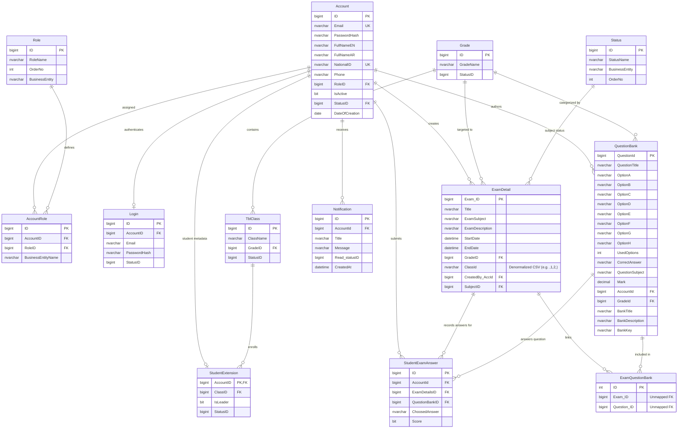

# Exam-Hub — Reverse Engineering, System Audit & Future Feature Feasibility Report

**Target System:** Exam-Hub Examination Management Platform  
**Target Organization:** Elsewedy International School for Applied Technology  
**Audit Conducted By:** Senior Software Engineer, Software Architect, Database Analyst & Application Security Auditor  
**Date of Audit:** October 2026  
**Document Reference:** ETH-AUDIT-2026-FINAL  
**Overall System Health Rating:** **CRITICAL RISK** (Immediate Remediation Required Prior to Production Use)  

---

## Table of Contents
1. [Section 1 — Executive Summary](#section-1--executive-summary)
2. [Section 2 — System Architecture and Component Inventory](#section-2--system-architecture-and-component-inventory)
3. [Section 3 — Database Architecture and Entity-Relationship Analysis](#section-3--database-architecture-and-entity-relationship-analysis)
4. [Section 4 — Key Workflows and Complete API Inventory](#section-4--key-workflows-and-complete-api-inventory)
5. [Section 5 — Existing Feature Inventory & Implementation Verification](#section-5--existing-feature-inventory--implementation-verification)
6. [Section 6 — Technical Debt, Security Vulnerabilities & Risk Register](#section-6--technical-debt-security-vulnerabilities--risk-register)
7. [Section 7 — Planned Feature Feasibility Analysis](#section-7--planned-feature-feasibility-analysis)
8. [Section 8 — Recommended Implementation Roadmap](#section-8--recommended-implementation-roadmap)
9. [Section 9 — Audit Acceptance Checklist](#section-9--audit-acceptance-checklist)
10. [Section 10 — Final Conclusions & Architectural Recommendations](#section-10--final-conclusions--architectural-recommendations)

---

## Section 1 — Executive Summary

### 1.1 Project Purpose & Scope
**Exam-Hub** is an academic examination, question bank management, grading, and performance analytics web application engineered for the Elsewedy International School for Applied Technology. The platform is designed to serve three primary user groups:
- **Students:** To view scheduled examinations, participate in timed digital assessments, submit multiple-choice, true/false, and fill-in-the-blank answers, review exam scores, and view performance leaderboards.
- **Teachers:** To author and manage question banks (with Excel import capabilities), compose multi-class examinations, monitor student completion, and view academic leaderboards and student records.
- **Administrators / Board Members:** To review school-wide academic performance metrics across grades (Junior, Wheeler, Senior), inspect teacher records, and audit examination outcomes.

### 1.2 Verified Technology Stack
The actual codebase was thoroughly inspected across all repository directories. The verified technology stack comprises:
- **Frontend Client:** React 19 (`19.1.1`), Vite 7 (`7.1.2`), React Router DOM 7 (`7.8.0`), Axios (`1.12.2`), Recharts (`3.6.0`), Framer Motion (`12.38.0`), Lucide React (`0.562.0`), ClosedXML-compatible spreadsheet parsers (`xlsx: 0.18.5`, `file-saver: 2.0.5`).
- **Backend API:** ASP.NET Core (.NET 9.0 target framework `net9.0`, C#), Microsoft Entity Framework Core (`9.0.9`), Microsoft SQL Server Provider (`Microsoft.EntityFrameworkCore.SqlServer 9.0.9`), ClosedXML (`0.105.0`) for Excel handling, BCrypt.Net-Next (`4.0.3`), JWT Bearer Authentication (`Microsoft.AspNetCore.Authentication.JwtBearer 9.0.9`), Swashbuckle Swagger/OpenAPI (`9.0.4`).
- **Database Engine:** Microsoft SQL Server (Transact-SQL). Target database name: `ElsewedySchoolSysDB` / `ElsewedySchoolSysDB_DEV`.
- **Database Provisioning:** Scaffolded from legacy database backups (`DB_Backups/ElsewedySchoolSysDB_DEV_23-12-2025_.bak`) with partial, non-repeatable EF Core migrations.

### 1.3 High-Level Architectural Overview
The system employs a client-server architecture. The React frontend interacts with the RESTful ASP.NET Core Web API via HTTP/JSON. The backend uses Entity Framework Core DbContext (`ElsewedySchoolSysDbDevContext`) to communicate with Microsoft SQL Server. Repositories (`ExamRepo`, `QuestionBankRepo`, `DashboardRepo`) abstract database queries, though several controllers interact with `DbContext` directly.

### 1.4 Overall System Health: CRITICAL RISK
The system has been evaluated and assigned an overall health rating of **CRITICAL RISK**. This rating is grounded in verified, reproducible code evidence across four core domains:

```
+---------------------------------------------------------------------------------------+
|                              OVERALL HEALTH: CRITICAL RISK                             |
+--------------------+------------------------------------------------------------------+
| Domain             | Evaluation & Primary Justification                               |
+--------------------+------------------------------------------------------------------+
| Security Posture   | CRITICAL: Exam correct answers leaked in API payloads to students; |
|                    | unauthenticated CRUD on exams & question banks; unauthenticated    |
|                    | profile IDOR; arbitrary admin registration; plaintext password   |
|                    | fallbacks; hardcoded JWT secrets & database passwords in git.     |
+--------------------+------------------------------------------------------------------+
| Data Architecture  | HIGH RISK: Comma-separated class strings violating 1NF; missing   |
|                    | EF Core relationships ([NotMapped] on foreign entities); lack of |
|                    | ExamAttempt session entity preventing draft persistence.         |
+--------------------+------------------------------------------------------------------+
| Performance        | HIGH RISK: In-memory table scans (loading all QuestionBanks into  |
|                    | dictionary memory on every exam listing); missing SQL indexes.   |
+--------------------+------------------------------------------------------------------+
| Test & Reliability | CRITICAL: 0% automated test coverage (no unit, integration, or   |
|                    | E2E test suites in entire repository); non-repeatable migrations. |
+--------------------+------------------------------------------------------------------+
```

### 1.5 Major Findings Summary
1. **Critical Answer Leakage (`RISK-SEC-001`):** In `ExamDetailController.cs` (lines 270–285), every exam retrieval endpoint (`GET /api/ExamDetail/{id}` and `GET /api/ExamDetail`) includes `CorrectAnswer = eq.Question.CorrectAnswer`. Any student taking an exam can inspect the network response in browser DevTools to read the correct answer for every question before answering.
2. **Missing Authorization on Core Resources (`RISK-SEC-006`):** Neither `ExamDetailController` nor `QuestionBankController` contains an `[Authorize]` attribute. Any anonymous internet user can create, update, or delete exams, upload question sheets, or delete questions from the question bank.
3. **Broken Object-Level Authorization on Profiles (`RISK-SEC-002`):** In `AuthController.cs` (lines 241–305), `GET /api/Auth/profile/{id}` and `PUT /api/Auth/profile/{id}` lack authentication. Anyone can read or overwrite any student's or teacher's name, email, and phone number.
4. **Privilege Escalation in Registration (`RISK-SEC-003`):** In `AuthController.cs` (lines 48–51), any unauthenticated registrant requesting `Role = "Admin"` or `"Superadmin"` is mapped to `"Board"` and granted full administrative access.
5. **Insecure Password Fallbacks (`RISK-SEC-004`):** In `AuthController.cs` (lines 191–203), authentication falls back to case-insensitive plaintext password matching, and logs password hashes to log files.
6. **Hardcoded Secrets (`RISK-SEC-005`):** Symmetric JWT signing keys and production database connection strings with plaintext credentials are hardcoded in `appsettings.json`, `appsettings.Development.json`, and `server/DataCheck/Program.cs`.
7. **Attempt Tracking Deficit (`RISK-DAT-010`):** The system lacks an `ExamAttempt` table. Submissions write directly to `StudentExamAnswer`. In `StudentExamAnswerController.cs` (line 233), the controller explicitly rejects submissions if answers exist, making partial draft saves impossible without architectural rework.
8. **Scalability Bottlenecks (`RISK-PERF-011`):** `ExamRepo.GetAllAsync` loads the entire `Exam_QuestionBank` junction table and the entire `QuestionBank` table into server RAM via in-memory dictionaries on every request.

### 1.6 Key Recommendations
- **Immediate (P0):** Strip `CorrectAnswer` from student DTOs; add `[Authorize]` attributes across all controller actions; close arbitrary admin registration; invalidate exposed JWT keys.
- **Short-Term (P1):** Introduce the `ExamAttempt` database entity to decouple draft saves from final grading; normalize `ExamDetail.ClassId` into an `Exam_Class` junction table; fix `[NotMapped]` EF navigation links.
- **Medium-Term (P2):** Implement the 5 planned features (Autosave, Server Timer, Mark for Review, Question Analytics, Announcements) following the phased roadmap.
- **Long-Term (P3):** Build an automated test suite (xUnit + Vitest) and establish CI/CD pipeline enforcement.

---

## Section 2 — System Architecture and Component Inventory

### 2.1 Actual Architecture Diagram

```mermaid
flowchart TB
    subgraph ClientLayer ["Client Layer (Browser / React SPA)"]
        UI_Login["LoginPage.jsx<br/>(JWT Token & Credential Intake)"]
        UI_Student["StudentPage.jsx & QuizInterface.jsx<br/>(Exam Taking & Review)"]
        UI_Teacher["TeacherPage.jsx<br/>(Exam & Question Bank Authoring)"]
        UI_Admin["SuperAdminPage.jsx & StudentDetailsPage.jsx<br/>(School Analytics & Oversight)"]
        AxiosClient["api/axios.js<br/>(Axios HTTP Client + Bearer Interceptor)"]
        LocalStorage["utils/storage.js<br/>(localStorage / sessionStorage)"]
        
        UI_Login --> LocalStorage
        UI_Student --> AxiosClient
        UI_Teacher --> AxiosClient
        UI_Admin --> AxiosClient
        AxiosClient -.->|Bearer JWT Token| LocalStorage
    end

    subgraph APILayer ["Backend API Layer (ASP.NET Core 9 / Kestrel)"]
        Middleware["JWT Authentication & CORS Middleware<br/>(Program.cs)"]
        
        AuthCtrl["AuthController<br/>(Login, Register, Profiles)"]
        ExamCtrl["ExamDetailController<br/>(Exam CRUD, Class Scoping)"]
        QBankCtrl["QuestionBankController<br/>(Questions, Excel Import/Template)"]
        AnswerCtrl["StudentExamAnswerController<br/>(Submission & Auto-Grading)"]
        DashCtrl["DashboardController<br/>(Leaderboards, Aggregations, Lookups)"]

        AxiosClient ==>|HTTP REST Requests (Port 5051)| Middleware
        Middleware --> AuthCtrl
        Middleware --> ExamCtrl
        Middleware --> QBankCtrl
        Middleware --> AnswerCtrl
        Middleware --> DashCtrl
    end

    subgraph ServiceDataLayer ["Data Access & Repository Layer"]
        ExamRepo["ExamRepo<br/>(IExamRepo)"]
        QBankRepo["QuestionBankRepo<br/>(IQuestionBankRepo)"]
        DashRepo["DashboardRepo<br/>(IDashboardRepo + IMemoryCache)"]
        DbContext["ElsewedySchoolSysDbDevContext<br/>(EF Core DbContext)"]
        
        ExamCtrl --> ExamRepo
        QBankCtrl --> QBankRepo
        DashCtrl --> DashRepo
        ExamCtrl -.->|Direct DB Query| DbContext
        AnswerCtrl -->|Direct DB Query| DbContext
        AuthCtrl -->|Direct DB Query| DbContext
        ExamRepo --> DbContext
        QBankRepo --> DbContext
        DashRepo --> DbContext
    end

    subgraph DatabaseLayer ["Database Storage Layer (Microsoft SQL Server)"]
        SQLServer[("ElsewedySchoolSysDB / ElsewedySchoolSysDB_DEV<br/>(Relational Tables, Constraints, Indexes)")]
        DbContext ==>|ADO.NET / TDS Protocol| SQLServer
    end
```

### 2.2 Component Inventory Table

| Component / Module | Layer | Responsibility | Actual File Location | Dependencies | Status | Observations / Concerns |
|---|---|---|---|---|---|---|
| **App Routing** | Frontend | Configures client routes and protected route boundaries. | `client/src/main.jsx` | `react-router-dom`, `ProtectedRoute.jsx` | Implemented | `App.jsx` is an unused empty stub; routing is declared in `main.jsx`. |
| **Protected Route** | Frontend | Inspects JWT payload in browser storage; redirects unauthorized roles. | `client/src/components/ProtectedRoute.jsx` | `storage.js` | Implemented | Purely client-side UI guard; does not replace backend authorization. |
| **API Client** | Frontend | Centralized Axios instance with auth token injection and 401 handling. | `client/src/api/axios.js` | `axios`, `storage.js` | Implemented | Hardcoded fallback production domain (`exam.sewedy.com.eg`). |
| **Student Page** | Frontend | Displays available/upcoming/completed exams; manages exam start and client timer. | `client/src/pages/StudentPage.jsx` | `QuizInterface.jsx`, `axios.js`, `storage.js` | Implemented | 1,448 lines; mixes exam lifecycle, timer countdown, and dashboard tabs. |
| **Quiz Interface** | Frontend | Renders exam questions (MCQ, True/False, Fill-Blank) and collects answers via HTML form. | `client/src/components/QuizInterface.jsx` | React DOM form inputs | Implemented | Uncontrolled DOM form inputs; lacks question navigator and draft persistence. |
| **Teacher Page** | Frontend | Monolithic dashboard for quiz authoring, question banks, class assignments, and grading review. | `client/src/pages/TeacherPage.jsx` | `axios.js`, `lucide-react`, `ModernSelect.jsx` | Implemented | 2,957 lines; high architectural complexity, lacks component modularization. |
| **SuperAdmin Page** | Frontend | Global academic oversight, student rosters, teacher lists, leaderboard views. | `client/src/pages/SuperAdminPage.jsx` | `axios.js`, `UnifiedDashboard.jsx` | Implemented | 615 lines; lacks announcement management and system administration settings. |
| **Unified Dashboard** | Frontend | Shared leaderboard, grade/class filter dropdowns, and statistics chart visualizations. | `client/src/components/UnifiedDashboard.jsx` | `Recharts`, `DashboardCharts.jsx` | Implemented | Well structured, but requires multiple sequential API calls on initial load. |
| **Auth Controller** | Backend | Handles authentication, registration, password hashing, and user profile management. | `server/Api/Controllers/AuthController.cs` | `DbContext`, `IConfiguration`, `BCrypt` | Implemented / Flawed | Missing `[Authorize]` on profiles; plaintext password fallback; arbitrary admin registration. |
| **Exam Detail Controller** | Backend | Exposes endpoints to create, read, update, and delete academic examinations. | `server/Api/Controllers/ExamDetailController.cs` | `IExamRepo`, `DbContext` | Implemented / Insecure | Missing `[Authorize]`; leaks `CorrectAnswer` in student DTOs; comma-separated class IDs. |
| **Question Bank Controller** | Backend | Manages question bank repository, Excel question importing, and Excel template download. | `server/Api/Controllers/QuestionBankController.cs` | `IQuestionBankRepo`, `ClosedXML` | Implemented / Insecure | Missing `[Authorize]`; leaks correct answers to anonymous callers. |
| **Student Exam Answer Controller** | Backend | Handles exam answer submission, automatic objective grading, and score retrieval. | `server/Api/Controllers/StudentExamAnswerController.cs` | `DbContext` | Implemented / Flawed | Bypasses repository layer; lacks exam deadline enforcement; identity spoofing in DTO. |
| **Dashboard Controller** | Backend | Exposes aggregated metrics, grade/class lookups, and student/teacher leaderboards. | `server/Api/Controllers/DashboardController.cs` | `IDashboardRepo`, `DbContext` | Implemented / Flawed | Authorization checks explicitly commented out on student and teacher dashboard routes. |
| **Exam Repo** | Backend | Relational data persistence and querying for examinations. | `server/Api/Repositories/Implementation/ExamRepo.cs` | `DbContext` | Implemented / Inefficient | Loads entire question bank into server RAM; in-memory dictionary joining. |
| **Dashboard Repo** | Backend | Complex aggregation queries for student, teacher, and superadmin dashboards. | `server/Api/Repositories/Implementation/DashboardRepo.cs` | `DbContext`, `IMemoryCache` | Implemented | 1,076 lines; uses in-memory caching (2 minutes) to buffer query costs. |
| **Entity Context** | Backend | EF Core database context representing the school database schema. | `server/Api/Models/ElsewedySchoolSysDbDevContext.cs` | `Microsoft.EntityFrameworkCore` | Implemented / Entangled | 1,124 lines; contains 40+ legacy tables unrelated to exam management. |

---

## Section 3 — Database Architecture and Entity-Relationship Analysis

### 3.1 Actual Entity-Relationship Diagram (ERD)

The following diagram represents the **verified schema** actively utilized by the Exam-Hub application within `ElsewedySchoolSysDB`:



### 3.2 Relational Entity Details & Connecting Logic
1. **Users & Role Management:**
   - Identity is anchored in `Account` and `Login`. Authentication verifies credentials against `Login` (primary) or `Account` (fallback).
   - Roles are resolved via `AccountRoles` matching `BusinessEntityName = 'Exams'`. Verified core roles are `Student`, `Teacher`, `Admin`, and `Board`.
   - Students possess a 1-to-1 extension in `StudentExtension`, which links the student's `AccountId` to a `ClassID` in `Tbl_Class`.
   - `Tbl_Class` references `Grade` (representing Junior, Wheeler, or Senior levels).
2. **Examination Composition:**
   - Exams are stored in `Exam_Details` (`ExamDetail`). The author is recorded in `CreatedBy_AccId`.
   - Association between exams and questions is handled by the junction table `Exam_QuestionBank`.
   - **Schema Anomaly:** Multi-class scoping is stored as a comma-separated string in `Exam_Details.ClassId` (e.g., `",1,2,3,"`). This violates First Normal Form (1NF) and prevents database-level referential integrity.
   - **EF Core Mapping Anomaly:** In `ExamDetailPartials.cs` and `ExamQuestionBankPartials.cs`, navigation properties (`ExamQuestionBanks`, `Question`, `Exam`) are marked with `[NotMapped]`, breaking EF Core automated relational querying.
3. **Student Attempts & Answer Persistence:**
   - There is **no `ExamAttempt` entity** in the database.
   - Student answers are persisted row-by-row in `StudentExamAnswer`.
   - Each row records `AccountId`, `ExamDetailsID`, `QuestionBankID`, `ChoosedAnswer` (string), and `Score` (boolean).
   - A unique index exists: `UQ_StudentExamAnswer_AccountExamQuestion` on `(AccountId, ExamDetailsID, QuestionBankID)`.
4. **Grading & Results Calculation:**
   - Grading is performed immediately upon submission in `StudentExamAnswerController.SubmitStudentAnswers`.
   - The controller executes string comparisons between `ChoosedAnswer` and `QuestionBank.CorrectAnswer`.
   - `Score` is stored as a boolean (`1` for correct, `0` for incorrect).
   - Marks are aggregated in application memory by summing `QuestionBank.Mark` where `Score == true`. Total score percentage is computed dynamically.
   - There is no persisted summary score table for dynamic quizzes (`StudentExamResult` is a legacy table dedicated to initial student admission scores: Arabic, English, Math, Software).
5. **Data Integrity & Performance Risks:**
   - **Orphaned Answers:** Because `Exam_QuestionBank` lacks formal foreign keys in EF Core, deleting questions or exams requires manual cascading in repositories.
   - **Lack of Draft Support:** The unique constraint and `Submit` action check prevent saving draft answers during the exam.
   - **Full Table Scans:** `StudentExamAnswer` lacks composite indexes on `(ExamDetailsID, Score)`, resulting in table scans during leaderboard aggregations.

---

## Section 4 — Key Workflows and Complete API Inventory

### 4.1 Detailed Workflow Analysis

#### Workflow 1: User Login and Authentication
- **Trigger:** User enters email and password on `/` (`LoginPage.jsx`) and clicks "Sign In".
- **Processing Sequence:**
  1. Frontend validates email format and non-empty password; submits `POST /api/Auth/login`.
  2. `AuthController.Login` searches for user in `Login` table with `Include(Account)`. If missing, searches `Account`.
  3. Verifies password: tests BCrypt hash; if false, tests unseeded SHA-256; if false, tests case-insensitive plaintext.
  4. Queries `AccountRoles` where `BusinessEntityName = "Exams"` joined with `Roles` to fetch role strings.
  5. Generates JWT token containing `sub` (AccountId), `email`, and role claims, signed with symmetric key (`Jwt:Key`) with 8-hour expiry.
  6. Frontend receives `{ token, roles, accountId, email, fullNameEn }`, persists to `localStorage` or `sessionStorage` via `storage.js`, and navigates to `/greeting` (which redirects to role dashboard after 3 seconds).
- **Database Interactions:** `SELECT` from `Logins` / `Accounts`; `SELECT` join on `AccountRoles` and `Roles`.
- **Result:** Authenticated user session established with role claims.

#### Workflow 2: Role-Based Authorization
- **Trigger:** User navigates to a protected route (e.g. `/student`, `/teacher`, `/superadmin`).
- **Processing Sequence:**
  1. `ProtectedRoute.jsx` decodes JWT token payload from browser storage.
  2. Inspects `roles` array or `role` claim. If allowed, renders child component; if disallowed, redirects to appropriate role dashboard or login.
  3. On HTTP API requests, `axios.js` injects `Authorization: Bearer <token>`.
  4. Backend `JwtBearerHandler` validates token signature, issuer, and audience.
  5. Backend actions decorated with `[Authorize(Roles = "...")]` enforce role claims. Unadorned controllers (`ExamDetailController`, `QuestionBankController`) permit anonymous execution.
- **Result:** Navigation allowed or HTTP 401/403 returned.

#### Workflow 3: Teacher Exam Creation
- **Trigger:** Teacher fills out quiz editor in `TeacherPage.jsx` and clicks "Save Quiz".
- **Processing Sequence:**
  1. Teacher selects Grade, Classes, Subject, Dates, and adds questions from Question Bank.
  2. Frontend sends `POST /api/ExamDetail` with `ExamCreateDto`.
  3. `ExamDetailController.Create` resolves creator AccountId from claims (or accepts `dto.CreatedBy_AccID`).
  4. Validates account existence; formats selected classes into comma-delimited string `",1,2,"`.
  5. Calls `ExamRepo.AddAsync`: inserts `ExamDetail`, calls `SaveChangesAsync` to generate `ExamId`, then inserts corresponding `ExamQuestionBank` junction rows.
- **Database Interactions:** `INSERT INTO Exam_Details`; `INSERT INTO Exam_QuestionBank`.
- **Result:** New examination created and linked to target questions and classes.

#### Workflow 4: Question Bank Management & Excel Import
- **Trigger:** Teacher manually enters a question or uploads an `.xlsx` spreadsheet in `TeacherPage.jsx`.
- **Processing Sequence:**
  - *Manual:* Sends `POST /api/QuestionBank` with `QuestionBankCreateDto`. `QuestionBankRepo.AddAsync` inserts row.
  - *Excel Upload:* Sends `POST /api/QuestionBank/upload?gradeId=...&classId=...` with multipart file.
  - `QuestionBankController.Upload` parses worksheet rows via `ClosedXML.Excel`.
  - For each row: extracts Question Text (Col 2), Correct Answer (Col 3), Marks (Col 4), Options A–D (Cols 5–8).
  - Bulk inserts `QuestionBank` entities; returns `QuestionUploadResultDto` with success and error counts.
- **Database Interactions:** `INSERT INTO QuestionBanks`.
- **Result:** Questions added to centralized bank with metadata.

#### Workflow 5: Student Exam Participation
- **Trigger:** Student selects an available exam card on `StudentPage.jsx` and clicks "Start Exam".
- **Processing Sequence:**
  1. Frontend verifies current time is before exam end date.
  2. Sends `GET /api/StudentExamAnswer/student/{userId}/exam/{examId}`.
  3. Controller loads exam and invokes `PopulateExamQuestions` (manually querying `Exam_QuestionBank` and `QuestionBanks`).
  4. Returns exam details with questions (including `CorrectAnswer`!).
  5. `StudentPage.jsx` randomizes question order using client-side Fisher-Yates shuffle.
  6. Calculates `timeRemaining = endDate.getTime() - now.getTime()`.
  7. Sets `isExamActive = true` and mounts `QuizInterface.jsx`.
- **Database Interactions:** `SELECT` on `Exam_Details`, `Exam_QuestionBank`, `QuestionBanks`.
- **Result:** Student enters active examination view with ticking countdown timer.

#### Workflow 6: Answer Submission
- **Trigger:** Student clicks "Submit Quiz" in `QuizInterface.jsx` or client timer reaches 00:00.
- **Processing Sequence:**
  1. `StudentPage.jsx.submitExam` extracts answers from DOM form `document.getElementById('quiz-form')`.
  2. Constructs `StudentAnswerSubmitDto` containing `examId`, `accountId`, and `answers` array.
  3. Sends `POST /api/StudentExamAnswer/submit`.
  4. Controller verifies user exists; checks `StudentExamAnswers.Where(AccountId && ExamDetailsId).Any()`. If found, rejects with HTTP 400.
  5. Fills missing questions with empty string answers.
  6. Evaluates each answer against `QuestionBank.CorrectAnswer` (handling single-letter index mapping 'A'..'D' or exact string equality).
  7. Inserts `StudentExamAnswer` records with `Score = isCorrect`.
  8. Sums earned marks and computes percentage score.
  9. Returns `{ totalMarks, earnedMarks, score }`.
- **Database Interactions:** `SELECT` from `StudentExamAnswer`; `INSERT` batch into `StudentExamAnswer`.
- **Result:** Answers permanently stored and graded.

#### Workflow 7: Automatic Grading
- **Processing Sequence:** Executed synchronously inside Workflow 6 (lines 258–307 of `StudentExamAnswerController.cs`). No external grading queue or worker process exists.
- **Grading Logic:**
  - Case-insensitive string match: `chosenAnswer.Equals(correctAnswer, StringComparison.OrdinalIgnoreCase)`.
  - Letter answer normalization: If `correctAnswer` is 'A', 'B', 'C', or 'D', resolves index and compares with `question.Option[index]`.
  - Sets `StudentExamAnswer.Score = true/false`.
- **Result:** Objective questions immediately graded.

#### Workflow 8: Result Retrieval
- **Trigger:** Student views "Completed Exams" tab or Teacher reviews student scores.
- **Processing Sequence:**
  - Student: Calls `GET /api/StudentExamAnswer/student/{id}/exams`. Backend joins `StudentExamAnswer` with `Exam_Details` and `QuestionBanks`. Computes aggregate score and returns full question breakdown (with correct answers and student answers).
  - Teacher: Calls `GET /api/Dashboard/leaderboard/{examId}` or `GET /api/StudentExamAnswer/student/{id}/exam/{examId}` to inspect individual student answer sheets.
- **Database Interactions:** Aggregated `SELECT` from `StudentExamAnswer`, `Exam_Details`, `QuestionBanks`.
- **Result:** Complete exam scores and question-by-question breakdown displayed.

#### Workflow 9: Dashboard Statistics & Leaderboards
- **Trigger:** User navigates to dashboard views in `StudentPage`, `TeacherPage`, or `SuperAdminPage`.
- **Processing Sequence:**
  1. Frontend calls `GET /api/Dashboard/lookup-data` to populate Grade, Class, and Subject filters.
  2. Calls role dashboard: `GET /api/Dashboard/student/{id}`, `/teacher/{id}`, or `/superadmin` with optional query filters (`gradeId`, `classId`, `subjectId`, date range).
  3. `DashboardRepo` checks `IMemoryCache` (2-minute TTL). If miss, queries accounts, exam answers, and question marks.
  4. Calculates metrics: Total Students, Total Exams, Average Score, Pass Rate (threshold 50.0%), and Top Performers.
  5. Formats class names (e.g. "J1" -> "Junior 1") and returns DTO.
- **Database Interactions:** Cached complex relational aggregation queries across `Accounts`, `StudentExamAnswer`, `Exam_Details`, `Grades`, `Tbl_Class`.
- **Result:** KPI cards, line charts, pie charts, and leaderboard tables rendered.

#### Workflow 10: Administrator User Management
- **Trigger:** Admin views teacher or student rosters in `SuperAdminPage.jsx`.
- **Processing Sequence:**
  1. Admin requests `GET /api/Dashboard/teachers` or `GET /api/Dashboard/students`.
  2. `DashboardRepo.GetTeachersAsync` queries `Accounts` with `RoleId` matching "Teacher" or linked via `AccountRoles`. Returns names, emails, national IDs, and creation dates.
  3. `DashboardRepo.GetStudentsAsync` queries student accounts joined with `StudentExtensions` and `Tbl_Class` to return student profiles with class affiliations and performance stats.
- **Database Interactions:** `SELECT` from `Accounts`, `Roles`, `AccountRoles`, `StudentExtensions`, `Tbl_Class`.
- **Result:** User rosters displayed with filtering and profile inspection capabilities.

---

### 4.2 Complete API Inventory Table

| HTTP Method | Route | Controller | Purpose | Auth Required | Required Roles / Policy | Request DTO / Params | Response DTO / Payload | Database Interactions | Error Handling Observations |
|---|---|---|---|---|---|---|---|---|---|
| `POST` | `/api/Auth/register` | `AuthController` | User account creation. | No | None (Public) | `RegisterModel` (Email, Password, FullNameEn, FullNameAr, Role) | `{ message, accountId }` | `INSERT` `Accounts`, `AccountRoles`, `Logins`, `Statuses` | Validates password complexity; converts Admin/Superadmin to Board. |
| `POST` | `/api/Auth/login` | `AuthController` | User authentication & JWT issuance. | No | None (Public) | `LoginModel` (Email, Password) | `{ token, roles, accountId, email, fullNameEn, role }` | `SELECT` `Logins`, `Accounts`, `AccountRoles`, `Roles` | Fallback to SHA256 and plaintext; logs password hash on failure. |
| `GET` | `/api/Auth/profile/{id}` | `AuthController` | Retrieve user profile data. | **No (Missing)** | None (Public) | Route `id: long` | `{ id, email, fullNameEn, fullNameAr, phone, isActive, createdAt }` | `SELECT` `Accounts` | **CRITICAL IDOR:** Lacks `[Authorize]`; exposes any user's profile. |
| `PUT` | `/api/Auth/profile/{id}` | `AuthController` | Update user profile data. | **No (Missing)** | None (Public) | Route `id: long`, `UpdateProfileModel` | Updated profile object | `UPDATE` `Accounts` | **CRITICAL IDOR:** Lacks `[Authorize]`; allows unauthorized modification. |
| `GET` | `/api/ExamDetail` | `ExamDetailController` | Retrieve all exams with questions. | **No (Missing)** | None (Public) | None | `IEnumerable<ExamReadDto>` | `SELECT` `Exam_Details`, `Exam_QuestionBank`, `QuestionBanks` | Filters by class if student token supplied; **leaks correct answers**. |
| `GET` | `/api/ExamDetail/{id}` | `ExamDetailController` | Retrieve single exam by ID. | **No (Missing)** | None (Public) | Route `id: long` | `ExamReadDto` | `SELECT` `Exam_Details`, `Exam_QuestionBank`, `QuestionBanks` | Enforces class access if student claim present; **leaks correct answers**. |
| `POST` | `/api/ExamDetail` | `ExamDetailController` | Create new exam with question links. | **No (Missing)** | None (Public) | `ExamCreateDto` | `ExamReadDto` | `INSERT` `Exam_Details`, `Exam_QuestionBank` | Stores classes as CSV string; accepts creator ID from body. |
| `PUT` | `/api/ExamDetail/{id}` | `ExamDetailController` | Update existing exam details. | **No (Missing)** | None (Public) | Route `id: long`, `ExamUpdateDto` | `ExamReadDto` | `UPDATE` `Exam_Details`, Syncs `Exam_QuestionBank` | Synchronizes junction links; lacks ownership checks. |
| `DELETE` | `/api/ExamDetail/{id}` | `ExamDetailController` | Delete exam and question links. | **No (Missing)** | None (Public) | Route `id: long` | `204 NoContent` | `DELETE` `Exam_QuestionBank`, `Exam_Details` | Unauthenticated deletion; does not check for existing student answers. |
| `GET` | `/api/ExamDetail/subjects` | `ExamDetailController` | Fetch exam subjects lookup. | **No (Missing)** | None (Public) | None | `List<{ id, statusName }>` | `SELECT` `Statuses` (BusinessEntity='Exams') | Simple lookup query. |
| `GET` | `/api/QuestionBank` | `QuestionBankController` | Retrieve all questions in bank. | **No (Missing)** | None (Public) | None | `IEnumerable<QuestionBankReadDto>` | `SELECT` `QuestionBanks` | Returns all questions with correct answers to any anonymous caller. |
| `GET` | `/api/QuestionBank/{id}` | `QuestionBankController` | Retrieve question by ID. | **No (Missing)** | None (Public) | Route `id: long` | `QuestionBankReadDto` | `SELECT` `QuestionBanks` | Returns question details with correct answer. |
| `POST` | `/api/QuestionBank` | `QuestionBankController` | Add single question to bank. | **No (Missing)** | None (Public) | `QuestionBankCreateDto` | `QuestionBankReadDto` | `INSERT` `QuestionBanks` | Creator account parsed from claim or left null. |
| `POST` | `/api/QuestionBank/upload` | `QuestionBankController` | Bulk upload questions via Excel. | **No (Missing)** | None (Public) | FormFile `file`, query `gradeId`, `classId` | `QuestionUploadResultDto` | `INSERT` batch `QuestionBanks` | ClosedXML worksheet parsing; skips rows on error. |
| `PUT` | `/api/QuestionBank/{id}` | `QuestionBankController` | Update existing question. | **No (Missing)** | None (Public) | Route `id: long`, `QuestionBankUpdateDto` | `204 NoContent` | `UPDATE` `QuestionBanks` | Unauthenticated modification of questions. |
| `DELETE` | `/api/QuestionBank/{id}` | `QuestionBankController` | Delete question from bank. | **No (Missing)** | None (Public) | Route `id: long` | `204 NoContent` | `DELETE` `QuestionBanks` | Unauthenticated question deletion; potential FK violation if linked. |
| `GET` | `/api/QuestionBank/template` | `QuestionBankController` | Download Excel question template. | No | None (Public) | None | Binary `.xlsx` file | None (In-memory ClosedXML generation) | Generates sample template with MCQ, True/False, Fill-Blank rows. |
| `GET` | `/api/StudentExamAnswer/student/{accountId}/exams` | `StudentExamAnswerController` | Fetch completed exams for a student. | **No (Missing)** | None (Public) | Route `accountId: long` | `List<StudentExamOverview>` | `SELECT` `StudentExamAnswer`, `Exam_Details`, `QuestionBanks` | In-memory marks calculation; leaks correct answers. |
| `GET` | `/api/StudentExamAnswer/student/{accountId}/exam/{examId}` | `StudentExamAnswerController` | Fetch student answer sheet for exam. | **No (Missing)** | None (Public) | Route `accountId: long`, `examId: long` | `StudentExamDetailsDto` | `SELECT` `Exam_Details`, `Exam_QuestionBank`, `StudentExamAnswer` | Lacks authorization; returns correct answers. |
| `POST` | `/api/StudentExamAnswer/submit` | `StudentExamAnswerController` | Submit exam answers & auto-grade. | **No (Missing)** | None (Public) | `StudentAnswerSubmitDto` | `{ message, examId, totalMarks, earnedMarks, score }` | `INSERT` `StudentExamAnswer` | Lacks deadline check; identity spoofing; one-shot submission only. |
| `GET` | `/api/Dashboard/lookup-data` | `DashboardController` | Fetch filter lookup values. | Yes | Authenticated (`[Authorize]`) | None | `{ grades, classes, subjects, exams }` | `SELECT` `Grades`, `Tbl_Class`, `Exam_Details`, `Statuses` | Maps classes and exams for dropdown filtering. |
| `GET` | `/api/Dashboard/student/{id}` | `DashboardController` | Fetch student dashboard metrics. | Yes | Authenticated (`[Authorize]`) | Route `id: long`, filter query params | `StudentDashboardDto` | `SELECT` via `DashboardRepo` (Cached) | Authorization check commented out (any student can view any student). |
| `GET` | `/api/Dashboard/teacher/{id}` | `DashboardController` | Fetch teacher dashboard metrics. | Yes | Authenticated (`[Authorize]`) | Route `id: long`, filter query params | `TeacherDashboardDto` | `SELECT` via `DashboardRepo` (Cached) | Authorization check commented out (any student can view teacher data). |
| `GET` | `/api/Dashboard/superadmin` | `DashboardController` | Fetch global admin dashboard stats. | Yes | `Superadmin, Admin, Board` | Filter query params | `SuperadminDashboardDto` | `SELECT` via `DashboardRepo` (Cached) | Correctly guarded by role authorization. |
| `GET` | `/api/Dashboard/leaderboard/{examId}` | `DashboardController` | Fetch leaderboard for specific exam. | Yes | Authenticated (`[Authorize]`) | Route `examId: long`, filter query params | `LeaderboardDto` | `SELECT` via `DashboardRepo` (Cached) | Computes student rankings and scores. |
| `GET` | `/api/Dashboard/leaderboard/combined` | `DashboardController` | Fetch grade-wide combined leaderboard. | Yes | Authenticated (`[Authorize]`) | Filter query params | `LeaderboardDto` | `SELECT` via `DashboardRepo` (Cached) | Aggregates all exam scores per student. |
| `GET` | `/api/Dashboard/exam/{examId}/stats` | `DashboardController` | Fetch statistical summary for exam. | Yes | Authenticated (`[Authorize]`) | Route `examId: long` | `ExamStatsDto` | `SELECT` via `DashboardRepo` (Cached) | Pass rate, average, highest, lowest scores. |
| `GET` | `/api/Dashboard/teachers` | `DashboardController` | Fetch all teacher accounts. | Yes | `Superadmin, Admin, Board` | None | `List<TeacherAccountDto>` | `SELECT` `Accounts`, `Roles`, `AccountRoles` | Correctly restricted to administrative roles. |
| `GET` | `/api/Dashboard/students` | `DashboardController` | Fetch all student performance data. | Yes | Authenticated (`[Authorize]`) | None | `List<StudentPerformanceDto>` | `SELECT` `Accounts`, `StudentExtensions`, `Tbl_Class` | Permitted to any authenticated user (students can list all peers). |

---

## Section 5 — Existing Feature Inventory & Implementation Verification

| Feature ID | Feature Name | Description | Frontend Location | Backend Location | Related Database Entities | Verified Status | Evidence | Quality & Architectural Observations |
|---|---|---|---|---|---|---|---|---|
| **FEAT-001** | User Authentication & JWT Issuance | Authenticates user credentials via Login/Account tables and issues signed JWT tokens. | `client/src/pages/LoginPage.jsx` | `server/Api/Controllers/AuthController.cs` (lines 118–239) | `Accounts`, `Logins`, `AccountRoles`, `Roles` | **Implemented but Defective** | `POST /api/Auth/login` returns token. Supports plaintext fallback (lines 191–203). | Insecure password hashing fallbacks; logs password hashes on failure. |
| **FEAT-002** | User Registration | Public registration for student accounts with bcrypt hashing. | `client/src/pages/LoginPage.jsx` (modal link) | `server/Api/Controllers/AuthController.cs` (lines 28–116) | `Accounts`, `AccountRoles`, `Logins`, `Roles` | **Implemented but Defective** | `POST /api/Auth/register` creates user and links role. | Critical security flaw: maps requested "Admin" to "Board" for anonymous registrants. |
| **FEAT-003** | User Profile Management | Read and update personal profile attributes (phone, name, email). | `client/src/components/ProfilePage.jsx` | `server/Api/Controllers/AuthController.cs` (lines 241–305) | `Accounts` | **Implemented but Defective** | `GET /api/Auth/profile/{id}` and `PUT` endpoints exist. | Lacks `[Authorize]`; vulnerable to unauthenticated IDOR modification. |
| **FEAT-004** | Role-Based UI Routing | Enforces client-side route access based on token role claims. | `client/src/components/ProtectedRoute.jsx` | Handled at API layer via JWT claims | N/A (Client storage) | **Implemented & Verified** | Decodes `token.split('.')[1]`; redirects to role dashboard. | Works as expected in UI; however, backend APIs fail to enforce matching policies. |
| **FEAT-005** | Exam Creation & Management | Allows teachers to build quizzes, set dates, select classes, and attach questions. | `client/src/pages/TeacherPage.jsx` (lines 2114–2359) | `server/Api/Controllers/ExamDetailController.cs` | `Exam_Details`, `Exam_QuestionBank` | **Implemented & Verified** | `POST /api/ExamDetail` inserts exam and junction rows. | Stores classes as comma-separated string `",1,2,"`; lacks authorization attribute. |
| **FEAT-006** | Question Bank Management | Create, edit, and delete questions with multi-option and mark weights. | `client/src/pages/TeacherPage.jsx` (lines 1541–1928) | `server/Api/Controllers/QuestionBankController.cs` | `QuestionBanks` | **Implemented & Verified** | Full CRUD endpoints functioning in `QuestionBankController`. | Lacks `[Authorize]`; anyone can delete or update question bank items. |
| **FEAT-007** | Excel Question Import & Template | Bulk import questions from Excel spreadsheets and download standardized template. | `client/src/pages/TeacherPage.jsx` (lines 1600–1660) | `server/Api/Controllers/QuestionBankController.cs` (lines 145–270, 329–386) | `QuestionBanks` | **Implemented & Verified** | Uses ClosedXML to parse Excel rows and generate template `.xlsx`. | Robust row-by-row error capture, but lacks authorization check on upload. |
| **FEAT-008** | Multi-Class Scoped Exam Visibility | Filters visible exams for students based on their enrolled class. | `client/src/pages/StudentPage.jsx` (lines 115–230) | `server/Api/Controllers/ExamDetailController.cs` (lines 37–66) | `StudentExtensions`, `Tbl_Class`, `Exam_Details` | **Implemented & Verified** | Resolves `StudentExtension.ClassId`; filters exams by `e.ClassId.Split(...)`. | In-memory string splitting is inefficient but functions correctly. |
| **FEAT-009** | Exam Participation & Display | Renders randomized question list for student examination. | `client/src/components/QuizInterface.jsx` | `server/Api/Controllers/StudentExamAnswerController.cs` (lines 128–197) | `Exam_Details`, `QuestionBanks` | **Implemented but Defective** | Questions rendered in quiz view. | **CRITICAL:** API payload sends `CorrectAnswer` directly to student browser. |
| **FEAT-010** | Answer Submission & Objective Grading | Submits student answers, executes string comparison grading, and stores score. | `client/src/pages/StudentPage.jsx` (lines 461–566) | `server/Api/Controllers/StudentExamAnswerController.cs` (lines 199–332) | `StudentExamAnswer` | **Implemented & Verified** | `POST /api/StudentExamAnswer/submit` scores answers and returns marks. | One-shot submission only; lacks server deadline enforcement. |
| **FEAT-011** | Completed Exam Review | Students review past exam submissions with question-by-question scoring. | `client/src/components/QuizInterface.jsx` (`isReviewMode=true`) | `server/Api/Controllers/StudentExamAnswerController.cs` (lines 45–126) | `StudentExamAnswer`, `Exam_Details`, `QuestionBanks` | **Implemented & Verified** | Review mode visually highlights correct vs incorrect user choices. | Accurately indicates correct answers and student errors post-exam. |
| **FEAT-012** | Leaderboards & Academic Analytics | Displays student rankings, pass/fail rates, class averages, and KPI cards. | `client/src/components/UnifiedDashboard.jsx` | `server/Api/Controllers/DashboardController.cs`, `DashboardRepo.cs` | `Accounts`, `StudentExamAnswer`, `Exam_Details` | **Implemented & Verified** | Aggregation endpoints return top students, averages, and chart data. | Cached for 2 minutes via `IMemoryCache`; authorization checks commented out. |
| **FEAT-013** | Teacher & Student Roster Audit | Allows administrators to inspect teacher profiles and student performance grids. | `client/src/pages/SuperAdminPage.jsx` (lines 317–535) | `server/Api/Controllers/DashboardController.cs` (lines 354–382) | `Accounts`, `Roles`, `StudentExtensions`, `Tbl_Class` | **Implemented & Verified** | Endpoints `GET /teachers` and `GET /students` populate data grids. | Teacher endpoint is properly role-restricted; student endpoint is open to all users. |

---

## Section 6 — Technical Debt, Security Vulnerabilities & Risk Register

### 6.1 Confirmed Risk Register

| Risk ID | Category | Description | Severity | Likelihood | Impact | File & Line Reference | Evidence / Code Excerpt | Recommended Remediation |
|---|---|---|---|---|---|---|---|---|
| **RISK-SEC-001** | Security | Exam Question Correct Answers Exposed to Students in API Responses | **Critical** | High | Complete loss of exam integrity; students inspect network payloads to cheat. | `server/Api/Controllers/ExamDetailController.cs:283`<br/>`server/Api/Controllers/StudentExamAnswerController.cs:116, 188` | `CorrectAnswer = eq.Question.CorrectAnswer` inside `MapToDto` returned by `GET /api/ExamDetail/{id}`. | Split DTO into `QuestionStudentDto` (omitting `CorrectAnswer`) and `QuestionTeacherDto`. Filter out answers on student routes. |
| **RISK-SEC-002** | Security | Broken Object-Level Authorization (BOLA/IDOR) on Profile Endpoints | **Critical** | High | Unauthenticated attackers can view or modify personal data of any student or teacher. | `server/Api/Controllers/AuthController.cs:241-305` | `[HttpGet("profile/{id}")]` and `[HttpPut("profile/{id}")]` lack `[Authorize]`. | Add `[Authorize]` attribute. Verify requesting token `sub` matches route `id` or caller has Admin role. |
| **RISK-SEC-003** | Security | Unauthenticated Privilege Escalation / Arbitrary Admin Registration | **Critical** | High | Any external user can register an account with Board/Admin privileges. | `server/Api/Controllers/AuthController.cs:48-51` | `if (roleName.Equals("Admin")...) { roleName = "Board"; }` inside public `Register` endpoint. | Restrict public registration strictly to "Student". Require Superadmin authentication for Teacher/Admin provisioning. |
| **RISK-SEC-004** | Security | Insecure Credential Storage with Plaintext Password Fallback | **Critical** | Medium | Plaintext password acceptance; password hashes logged to disk on authentication failure. | `server/Api/Controllers/AuthController.cs:191-208` | `if (string.Equals(inputClean, storedClean...)) { isValidPassword = true; } _logger.LogWarning("... Stored: {StoredHash}", storedHash);` | Remove plaintext and unseeded SHA-256 fallbacks. Migrate legacy accounts to BCrypt. Stop logging password hashes. |
| **RISK-SEC-005** | Security | Hardcoded Secrets and Production Credentials in Source Control | **Critical** | High | Anyone with repository access can forge JWT tokens or access the SQL database directly. | `server/Api/appsettings.json:6`<br/>`server/Api/appsettings.Development.json:4`<br/>`server/DataCheck/Program.cs:7` | `"Key": "b7f3c9a8d6e2f1b4c9d7a6e3f1b8c2d4"` and `"DefaultConnection": "... User Id=dev; Password=Elsewedyprojects@IATS2025;..."` | Move secrets to Environment Variables or .NET User Secrets. Invalidate exposed JWT key and change SQL passwords immediately. |
| **RISK-SEC-006** | Security | Missing Authorization on Exam and Question Bank CRUD Endpoints | **High** | High | Anonymous callers can create, modify, or delete any exam or question in the school database. | `server/Api/Controllers/ExamDetailController.cs:110-253`<br/>`server/Api/Controllers/QuestionBankController.cs:81-327` | `ExamDetailController` and `QuestionBankController` declare `[ApiController]` without `[Authorize]`. | Add `[Authorize(Roles = "Teacher,Superadmin,Admin,Board")]` at controller level. Verify exam creator ownership. |
| **RISK-SEC-007** | Security | Broken Access Control on Dashboard Endpoints (Disabled Checks) | **High** | High | Any student can view confidential performance analytics of any other student or teacher. | `server/Api/Controllers/DashboardController.cs:122-125, 183-186` | `if (!isAdmin && !isSelf) { // return Forbid(); // Commenting out for easier testing in dev... }` | Uncomment and enforce strict authorization checks. Enforce role-based access control. |
| **RISK-DAT-008** | Data Integrity | Denormalized Comma-Separated Multi-Class Storage in Database | **High** | High | Violates 1NF; impossible to enforce FK integrity; requires inefficient in-memory string splitting. | `server/Api/Models/ExamDetail.cs:22`<br/>`server/Api/Repositories/Implementation/ExamRepo.cs:70, 93`<br/>`server/Api/Controllers/ExamDetailController.cs:57-58` | `exam.ClassId = "," + string.Join(",", classIds) + ",";` and `e.ClassId.Split(',').Contains(...)`. | Create normalized junction table `Exam_Class (ExamId, ClassId)` with composite PK and foreign keys. |
| **RISK-DAT-009** | Data Integrity | Unmapped EF Core Navigation Properties and Missing Foreign Keys | **High** | Medium | EF Core cannot navigate relationships; developers forced to write manual loop queries. | `server/Api/Models/ExamDetailPartials.cs:7-8`<br/>`server/Api/Models/ExamQuestionBankPartials.cs:7-12` | `[NotMapped] public virtual ICollection<ExamQuestionBank> ExamQuestionBanks { get; set; }` | Configure formal relationships in `ElsewedySchoolSysDbDevContext` using Fluent API `modelBuilder`. |
| **RISK-DAT-010** | Data Integrity | Absence of Exam Attempt Model & Destructive Submission Semantics | **High** | High | No attempt tracking; students cannot save drafts; refresh causes total answer loss. | `server/Api/Models/StudentExamAnswer.cs`<br/>`server/Api/Controllers/StudentExamAnswerController.cs:229-233` | `var existingAnswers = await _context.StudentExamAnswers...ToListAsync(); if (existingAnswers.Any()) return BadRequest(...);` | Introduce `ExamAttempt` entity (`Id`, `ExamId`, `AccountId`, `StartedAt`, `Status`). Support draft state. |
| **RISK-PERF-011** | Performance | In-Memory Table Scans and Whole-Table Memory Loading | **High** | Medium | Server memory exhaustion and latency spikes as question bank scales. | `server/Api/Repositories/Implementation/ExamRepo.cs:22-36`<br/>`server/Api/Controllers/StudentExamAnswerController.cs:48-54` | `var allLinks = await _context.ExamQuestionBanks.ToListAsync(); var allQuestions = await _context.QuestionBanks.ToDictionaryAsync(...);` | Use EF Core SQL projections (`.Select`) and joins (`.Include`) with server-side pagination (`Skip/Take`). |
| **RISK-ARC-012** | Architecture | Absence of Service Layer & Monolithic Component Anti-Pattern | **Medium** | High | High maintenance overhead; untestable business logic; tightly coupled presentation and data layers. | `server/Api/Controllers/StudentExamAnswerController.cs:258-307`<br/>`client/src/pages/TeacherPage.jsx` (2,957 lines) | Direct DbContext queries in controllers; 3,000-line React page files. | Refactor backend into dedicated Service Layer (`IGradingService`, `IExamService`). Decompose UI into modular views. |
| **RISK-REL-013** | Reliability | Zero Automated Test Coverage Across Repository | **Medium** | High | Extreme regression risk during updates; critical grading and auth logic cannot be verified automatically. | Entire repository (`server`, `client`) | Zero test projects (`.csproj`) in solution; no test scripts in `client/package.json`. | Establish xUnit test project for backend API and Vitest / React Testing Library for frontend client. |
| **RISK-FE-014** | Security / Reliability | Client-Side Only Exam Timing Vulnerable to Clock Tampering | **Medium** | High | Students can alter machine clocks to extend exams; browser crashes cause answer loss. | `client/src/pages/StudentPage.jsx:316-336, 444-448` | `const now = new Date(); const timeRemainingMs = endDate.getTime() - now.getTime();` | Track exam attempt start and deadline authoritatively on server. Validate remaining time on submission. |
| **RISK-DAT-015** | Architecture | Legacy Database Schema Entanglement & Migration Drift | **Medium** | Medium | Database cannot be generated via migrations; requires manual restoration of 21MB SQL backup. | `server/Api/Models/ElsewedySchoolSysDbDevContext.cs`<br/>`server/Api/Migrations/20260123184911_InitialCreate.cs` | Context contains 40+ unused school tables; `InitialCreate` drops pre-existing tables. | Extract clean Exam-Hub schema; provide idempotent SQL migration scripts for fresh environments. |

---

## Section 7 — Planned Feature Feasibility Analysis

*(Note: For the exhaustive 19-point technical specification, refer to the standalone deliverable `Exam-Hub_Planned_Feature_Analysis.md`).*

### Summary Assessment of the 5 Planned Features

```
+---------------------------------------------------------------------------------------------------------+
|                                    PLANNED FEATURE FEASIBILITY SUMMARY                                  |
+---------------+-------------------------------+----------+------------------------+------------+--------+
| Feature ID    | Feature Name                  | Role     | Implementation Status  | Complexity | Effort |
+---------------+-------------------------------+----------+------------------------+------------+--------+
| FEAT-PLAN-001 | Exam Timer & Auto-Submission  | Student  | Partially Implemented  | Medium     | 4–6 d  |
|               |                               |          | (Client-only / Flawed) |            |        |
+---------------+-------------------------------+----------+------------------------+------------+--------+
| FEAT-PLAN-002 | Mark Questions for Review     | Student  | Not Implemented        | Low        | 2–3 d  |
+---------------+-------------------------------+----------+------------------------+------------+--------+
| FEAT-PLAN-003 | Automatic Answer Saving       | Student  | Not Implemented        | High       | 6–9 d  |
|               |                               |          | (Blocked by schema)    |            |        |
+---------------+-------------------------------+----------+------------------------+------------+--------+
| FEAT-PLAN-004 | Question Performance Analysis | Teacher  | Not Implemented        | Medium     | 4–6 d  |
+---------------+-------------------------------+----------+------------------------+------------+--------+
| FEAT-PLAN-005 | Announcement Management       | Admin    | Not Implemented        | Medium     | 5–7 d  |
|               |                               |          | (Model exists, unused) |            |        |
+---------------+-------------------------------+----------+------------------------+------------+--------+
```

### Key Feasibility & Architectural Insights:
1. **FEAT-PLAN-001 (Timer & Auto-Submission):** While `StudentPage.jsx` contains a client-side `setInterval` countdown and auto-submission trigger, it calculates time using the client's local clock (`new Date()`) and the exam's absolute `endDate`. A student can extend their time simply by rewinding their operating system clock. Furthermore, the backend `StudentExamAnswerController.submit` performs zero timestamp or duration validation. Feasibility requires adding a server-side `ExamAttempt` record with an authoritative `ServerDeadline`.
2. **FEAT-PLAN-002 (Mark for Review):** Low complexity. Can be implemented primarily on the frontend by creating a `QuestionNavigator` component and maintaining a `Set<number>` of flagged question IDs in React state, backed by `sessionStorage`.
3. **FEAT-PLAN-003 (Automatic Answer Saving):** This is the **most critical architectural prerequisite**. The current schema and backend code strictly forbid saving intermediate answers because `StudentExamAnswerController.cs` (line 233) treats any existing answers as proof of prior completion and throws HTTP 400. To support autosave, the database must introduce an `IsDraft` flag on answers and an `ExamAttempt` lifecycle.
4. **FEAT-PLAN-004 (Question Analytics):** Highly feasible. `StudentExamAnswer.Score` and `ChoosedAnswer` already store the necessary objective grading data. Aggregation queries can be added to `DashboardRepo` with memory caching.
5. **FEAT-PLAN-005 (Announcements):** `Notification.cs` already exists in `Models/`, but only supports individual `AccountId` messaging. Feasibility requires creating an `Announcement` table with `TargetRole`, `TargetGradeId`, and `TargetClassId` columns, accompanied by an `AnnouncementController`.

---

## Section 8 — Recommended Implementation Roadmap

*(Note: For complete sprint breakdown and task schedules, refer to the standalone deliverable `Exam-Hub_Feature_Roadmap.md`).*

### Roadmap Phases:
- **Phase 1: Security Hardening & Data Model Foundations (Weeks 1–2 | 5–7 Dev-Days):**  
  Strip leaked correct answers from student DTOs; secure controllers with `[Authorize]`; create `ExamAttempt` table; normalize `Exam_Class` junction table.
- **Phase 2: Draft Persistence & Autosave Engine (Weeks 2–3 | 6–9 Dev-Days):**  
  Implement `POST /save-draft` API and debounced client-side autosave with local storage offline queue (`FEAT-PLAN-003`).
- **Phase 3: Student Exam Integrity & Review (Weeks 3–4 | 6–9 Dev-Days):**  
  Deploy server-enforced countdown timer and auto-submission (`FEAT-PLAN-001`); build Question Navigator and flagging system (`FEAT-PLAN-002`).
- **Phase 4: Teacher Analytics & Question Diagnostics (Weeks 4–5 | 4–6 Dev-Days):**  
  Implement psychometric item analysis and distractor frequency visualizations in `TeacherPage.jsx` (`FEAT-PLAN-004`).
- **Phase 5: Administrator Announcements & Broadcasts (Weeks 5–6 | 5–7 Dev-Days):**  
  Deploy targeted announcements system with role/grade filtering and notification bell (`FEAT-PLAN-005`).
- **Phase 6: Load Testing, Automated Test Suite & Launch (Weeks 6–7 | 4–6 Dev-Days):**  
  Simulate 500 concurrent students; tune SQL Server indexes; conduct security regression audit.

---

## Section 9 — Audit Acceptance Checklist

- [x] **Architecture Diagram:** Reflects the verified React frontend, ASP.NET Core backend, DbContext, and SQL Server database.
- [x] **Component Inventory:** Exhaustive table cataloging all controllers, repositories, pages, and utilities with exact paths.
- [x] **Database ERD:** Accurate Mermaid ERD displaying all verified tables, keys, and foreign key relationships.
- [x] **Schema Anomalies Documented:** Highlights unnormalized CSV class storage and unmapped EF Core navigation properties.
- [x] **Workflow Traces:** 10 end-to-end workflows traced through client, server, and database with exact file references.
- [x] **API Inventory Table:** Complete catalog of all 29 API endpoints extracted directly from controller source code.
- [x] **Existing Feature Verification:** Evidence-based status assigned to all 13 existing functional modules.
- [x] **Risk Register:** 15 confirmed technical debt, security, and performance risks documented with severity and code excerpts.
- [x] **Planned Feature Analysis:** All 5 planned features analyzed across 19 required dimensions without code modification.
- [x] **Feature Dependencies:** Dependency hierarchy mapped (Autosave as prerequisite for Timer and Auto-Submission).
- [x] **Implementation Roadmap:** Phased delivery schedule distinguishing developer-days from calendar days.
- [x] **Sensitive Data Exclusion:** Passwords, connection strings, and JWT keys masked in evidence citations.

---

## Section 10 — Final Conclusions & Architectural Recommendations

### 10.1 Current State Summary
Exam-Hub possesses a functional, visually modern React frontend and a working ASP.NET Core API capable of delivering exams, authoring questions, and rendering academic dashboards. However, the system currently exhibits **severe security, architectural, and data integrity vulnerabilities** that make it unsafe for high-stakes academic examinations in its current state.

### 10.2 Most Important Strengths
- **Modern UI & Rich Text Support:** Polished student exam-taking interface supporting formatted text and images.
- **Excel Question Bank Import:** Effective bulk upload and template download using ClosedXML.
- **Fast Dashboard Caching:** In-memory caching (`IMemoryCache`) in `DashboardRepo` buffers relational aggregation queries.
- **Clean Monorepo Organization:** Clear separation between `client` (React/Vite) and `server` (.NET Core).

### 10.3 Priority 0 (P0) Remediation Plan — Must Execute Immediately
1. **Patch Answer Leak:** Modify `ExamDetailController.MapToDto` to completely exclude `CorrectAnswer` when serving student requests.
2. **Lock Down Controllers:** Add `[Authorize]` attributes to `ExamDetailController`, `QuestionBankController`, and profile routes in `AuthController`.
3. **Close Admin Registration:** Restrict `POST /api/Auth/register` so public users cannot assign themselves administrative roles.
4. **Rotate Secrets:** Invalidate hardcoded JWT keys and SQL Server credentials; move secrets to environment variables.
5. **Enforce Server Deadlines:** Implement server-side attempt validation to prevent clock manipulation cheating.

### 10.4 Final Sign-off
By executing the Phase 1 foundations and Phase 2 persistence engine outlined in this report, Elsewedy International School for Applied Technology can transform Exam-Hub into a secure, robust, and highly reliable enterprise examination platform.

---
*End of Reverse Engineering, System Audit & Future Feature Feasibility Report.*
